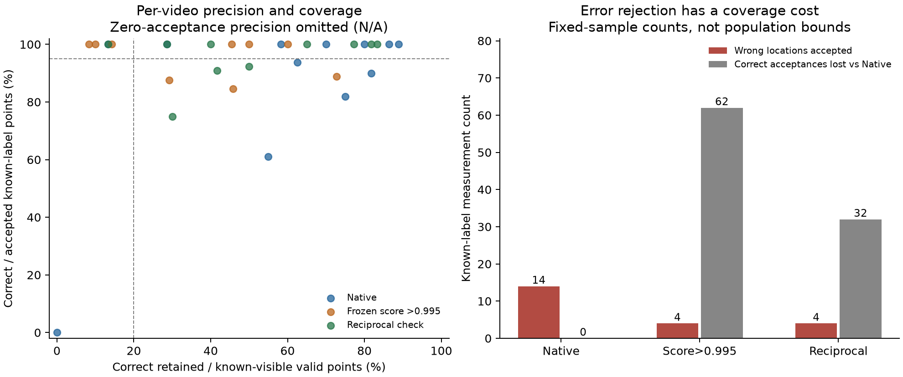

# Research Portfolio

**Huanyun Jiang · Agentic AI research experience**

Two research projects on a shared question: **how can we tell whether an AI system's updates and predictions are trustworthy?** This portfolio brings together experimental code, reports, numerical evidence, and interview presentation materials.

The first project examines model adaptation and attribution of optimization gains. The second examines physical consistency, measurement validity, and verification in video world models. The Agentic AI connection is reliable adaptation and evidence-based decision making; neither project is presented as a completed general-purpose agent.

**Snapshot: 18 November 2026.** Historical reports are preserved as research records. The interview summaries and [evidence guide](EVIDENCE_GUIDE.md) explain later corrections and current limits.

## Start here / 展示入口

| Material | Read online | PDF |
|---|---|---|
| Interview material guide / 使用说明与证据边界 | [Markdown](interview/00_面试使用说明与证据边界.md) | [PDF](interview/00_面试使用说明与证据边界.pdf) |
| Project 1: optimization and LoRA / 优化与LoRA | [Full introduction](interview/01_优化与LoRA_完整介绍.md) | [PDF](interview/01_优化与LoRA_完整介绍.pdf) |
| Project 2: video physical consistency / 视频物理一致性 | [Full introduction](interview/02_视频物理一致性_完整介绍.md) | [PDF](interview/02_视频物理一致性_完整介绍.pdf) |

For the **project experience overview** interview segment, begin with the two project introductions. Their methods, experiment settings, results, and boundaries are also useful for a deeper technical discussion. The original three preparation documents are preserved in full.

### Agentic AI reading / Agentic AI 面试读物

Nine papers explained through research questions, methods, evidence limits, worked teaching examples, proposed experiments, and interview practice. The Chinese and English versions provide corresponding complete explanations; suggested experiments are not presented as completed work.

- [Reading guide index / 读物目录](interview/reading-guide/README.md)
- [中文完整详解](interview/reading-guide/reading-guide.zh.md) · [Complete English guide](interview/reading-guide/reading-guide.en.md)
- [Sources and reading scope / 来源与阅读范围](interview/reading-guide/SOURCES.md)

## 1. Optimization and LoRA for LLM adaptation

**Question.** Can alternating optimization improve model adaptation, and how can optimizer effects be separated from parameterization effects?

**Work.** An experimental framework compares AdamW and alternating ALS/SGD/perturbation approaches under full-rank and LoRA parameterizations, across small models and Qwen2.5-7B. Follow-up experiments investigate unstable ALS updates, the actual timing of gradient injection, learning-rate schedules, and downstream performance.

**Outcome.** The project produced an implementation, experiment records, reports, and negative results. A gradient-injection component was found to execute after the parameter update and to be cleared before the next one. Simple controls changed the interpretation of its apparent gains. Early evaluation and resource-accounting issues limit several historical performance claims; this portfolio does not claim a validated new optimizer that outperforms LoRA.

**Agentic AI relevance.** Reliable model adaptation, preservation of capabilities, and checking whether an added component actually improves behavior.

- [Source framework](projects/alternating-optimization-lora/altopt/)
- [Experiment scripts](projects/alternating-optimization-lora/experiments/) · [Tests](projects/alternating-optimization-lora/tests/)
- [Paper/report PDF](projects/alternating-optimization-lora/Final_Report.pdf) · [Poster PDF](projects/alternating-optimization-lora/jianghuanyun_Poster.pdf)
- [Detailed report with later corrections](projects/alternating-optimization-lora/docs/final-report.md)
- [Gradient-injection diagnosis](projects/alternating-optimization-lora/docs/diag-injection-report.md)
- [Machine-readable results](projects/alternating-optimization-lora/runs/) · [Paper source and drafts](projects/alternating-optimization-lora/paper/)

The report and poster are historical artifacts, not evidence of peer-reviewed publication. Use the current introduction and evidence guide when presenting quantitative conclusions.

## 2. Physical consistency and reliable measurement in video world models

**Question.** When does a generated video provide enough reliable evidence for a physical judgment?

**Work.** A pipeline combines video generation, tracking, visibility and identity checks, geometry, physical relations, and calibrated visual judging. Experiments include 24 original Part A videos, 48 Part B production videos with 8 controls, controlled gravity relations, public tracking benchmarks, and participant-disjoint relocalization probes. A separate linear action-conditioned pilot tests the connection between state prediction and closed-loop planning.

**Outcome.** The engineering pipeline runs, but reliable generator ranking remains incomplete. None of the original 24 generated videos passed the complete numerical-fitting gate; this is a measurement limitation, not a zero physical-correctness score. Real-domain experiments expose the trade-off between accepted precision and coverage. The latest static MASt3R comparison did not support replacing the native tracker.

**Agentic AI relevance.** Verifying observations and predicted consequences, separating uncertainty from errors, and identifying when an agent should obtain more evidence.

- [Current project and experiment index](projects/world-model-part-b-20261113/README.md)
- [Complete English research report](projects/world-model-part-b-20261113/report/report.md)
- [Experiment code](projects/world-model-part-b-20261113/research/) · [Unified measurement pipeline](projects/world-model-part-b-20261113/benchmark/physcheck/relations/)
- [Latest participant-disjoint results](projects/world-model-part-b-20261113/research/reference_relocalization_20261117/report_v2/REPORT.zh.md)
- [Original proposal outcomes and open tasks](projects/world-model-part-b-20261113/docs/PROPOSAL_RESULTS_2026-11-17.zh.md)
- [Action-conditioned pilot](projects/world-model-part-b-20261113/research/action_world_stage0_20261114/results/REPORT.md)
- [Milestone PDF](projects/world-model-part-b-20261113/report/AIST4010_Milestone_JIANG_Huanyun.pdf)
- [Earlier project snapshot](projects/world-model-physical-consistency/README.md)



The figure belongs to the 12-video development-era study. Its higher accepted precision comes with lost coverage and recovery; the latest participant-disjoint follow-up is linked above.

## Files, downloads, and reproduction

```text
interview/                                  Chinese introductions and three PDFs
projects/alternating-optimization-lora/       Optimization source, reports, figures, results
projects/world-model-part-b-20261113/        Current video research source and results
projects/world-model-physical-consistency/  Earlier video project snapshot
provenance/                                 File inventories, SHA-256 hashes, exclusions
tools/                                     Result restoration and integrity verification
```

Large numerical arrays are distributed through the [portfolio snapshot release](https://github.com/gingersea/research-portfolio/releases/tag/portfolio-2026-11-18). Large JSON result logs are losslessly stored as `.json.gz`, alongside smaller `.summary.json` navigation previews. See [downloads and reproduction](DOWNLOADS.md).

This is a source-and-results portfolio, not a bundled training environment. Large model/optimizer checkpoints, virtual environments, agent-local metadata, and raw input caches are excluded and inventoried. Preparation scripts and experiment provenance remain available. Historical absolute workstation paths may require adaptation for a new machine; no clean-machine training reproduction is claimed by this packaging step.

## Evidence and authorship

Read [EVIDENCE_GUIDE.md](EVIDENCE_GUIDE.md) before quoting archived performance claims. Existing reports retain their original disclosures, acknowledgements, and source attributions, including AI assistance. Third-party models and data retain their own terms; the repository does not add a blanket license over them.
