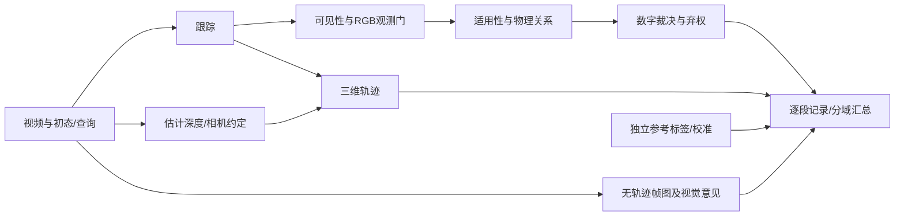

# 项目整体总结与后续路线（截至2026-11-16）

## 一、目前处在什么阶段

我们已完成多轮生成、测量校准、公开标签验证和失败诊断，建成可追溯、允许弃权的完整视频物理一致性评估流水线。**工程流程已经跑通，真实生成视频的可靠物理评分仍未完成。** 目前可以交付的是实验框架、固定基线、受限条件下的校准结果和明确的失败边界。

尚没有可靠的生成器物理能力排行榜，没有证明估计深度三维模型全面优于二维方案，也没有训练出通用视觉/动作世界模型。此前的检测器训练和线性动作试点各有明确范围。

当前工作问题可表述为：给定视频及必要初态信息，能否在可核验的定位、可见性、身份和几何证据下，输出物理关系判断，并对不可测样本明确弃权？按用户最新要求，下一阶段围绕完整流程验证，局部优化排在外部端到端基线验证之后。

这份文件统一当前状态和路线；历次dated报告仍是对应实验的原始证据。旧报告的“下一步”“尚未运行”只表示其当时状态，不能覆盖后来的实际运行。11月14动作条件试点已经完成阶段0，后续尚未展开；它是历史支线，不是当前唯一主线。早期气象方案已退出当前研究路线。

## 二、我们做了什么

|阶段|实际完成|主要结果及边界|证据|
|---|---|---|---|
|早期Part A|Wan/CogVideoX，2模型×4提示×3种子，24视频、1560帧；跟踪和参数拟合|Wan跟踪11/12、CogVideoX5/12；完整有效物理拟合0/24。表示仪器/标定门未通过，不是视频物理正确率为0|[原结果](../report/part_a_halfway_results.md)、[审计](../benchmark/results/raw/part_a_audit.json)|
|检测器和迁移|29,465参数TinyUNet试点；生成帧迁移检查；120张匿名标注帧包|合成测试IoU约0.970；生成视频缺独立标签，不能直接外推|[11月12总结](RESULTS_2026-11-12.zh.md)、[迁移](../research/transfer_20261109T143307Z/REPORT.zh.md)|
|尺度与误报|256场景尺度压力测试；两训练臂×3种子，6个新检查点、23040条重复指标|最小目标预设IoU差-0.02078，条件95%区间[-0.02976,-0.01154]；部分中目标改善，但部分负例误报上升，未解决可靠小目标测量|[压力测试](../research/stress_20261109T144046Z/REPORT.zh.md)、[训练](../research/multiscale_20261109T191120Z/REPORT.zh.md)|
|Part B生产|48正式片+8校准片、56次隔离判断、448采样图|生成/抽帧/盲评/聚合均执行；校准控制没有保证真实违反可见，校准无效，正式物理率和有效排名为N/A|[报告](../research/part_b_20261113T114040Z/REPORT.md)、[proposal核对](../research/part_b_20261113T114040Z/PROPOSAL_AUDIT.zh.md)|
|阶段收尾|50种抽帧条件枚举；12对/24段无损反例|每对完整视频不同，但8帧输入逐字节相同，量化了可观测性盲区；没有测得VLM准确率或新颖性|[收尾](CLOSEOUT_AND_PIVOT_2026-11-14.zh.md)|
|动作条件支线|完全可观测无噪线性世界，6次最小二乘拟合、128测试轨迹、64配对规划场景|动作条件各64/64、动作盲各0/64；只是恰在线性模型族内的接口基线，不是视觉世界模型或规划方法优势|[阶段0](../research/action_world_stage0_20261114/results/REPORT.md)|
|论文调查/方法试用|8篇方法阅读；VideoPhy2公开3397行人工表复算；VPT/匹配Wan对照正式生成6段|公开标签字段复算一致；发布VPT可运行。未完成其自动评估器校准，未证明6段样例物理改善|[方法与试用](../research/physics_methods_20261114/REPORT.zh.md)、[阅读表](../research/physics_methods_20261114/LITERATURE_REVIEW.zh.md)|
|受控双物体关系|借鉴Principia的高度比/飞行时间平方比；4开发+24留出场景、6条件、两编码，共336编码视频；12首次独立视觉裁判|288留出编码案例符合预定PASS/FAIL/ABSTAIN；限定程序分布的测量与裁判门通过，不是完整Principia或真实域校准|[关系校准](../research/principia_gravity_20261114/REPORT.zh.md)|
|原生I2V小试|LTX原生I2V，2初态×2种子，4段97帧；没有粘贴输入首帧|初态保持4/4通过，覆盖门0/4，可用物理关系0/4，停止扩样；四段仍是后续重跑的同四段|[原生I2V](../research/principia_i2v_20261115/REPORT.zh.md)|
|二维/身份/三维分解|覆盖失败审计；原生CoTracker3；独立RGB观测门；作者完整TAPIP3D和同深度二维基线对照|简单控制可通过，但身份替换/歧义仍暴露错误；拒绝错误不等于恢复。深度与正确二维对应必须分别验证|[审计](../research/tracking_audit_20261115/REPORT.zh.md)、[二维基线](../research/tracking_validation_20261115/REPORT.zh.md)、[观测门/完整三维](../research/observation_gate_20261115/REPORT.zh.md)|
|身份恢复V1/V2|两轮各48新程序视频，V2含36留出；真实I2V参考/人工标注包；估计深度链路|V1失败保留；V2留出恢复15/15，正确点保留95.80%，但只属受控数据；真实I2V和两个普通单序列仍有缺口，未生产升级|[完整报告](../research/identity_recovery_20261115/REPORT.zh.md)、[V2](../research/identity_recovery_multiscale_20261115/REPORT.zh.md)|
|论文标注素材验证|官方DAVIS全部30段、650轨迹、1999帧逐查询运行；PStudio3段前64帧、每段8查询|CoTracker3 AJ60.56%、APD75.08%、OA86.89%；恢复235/363。三维误差Co+深度26.82cm、TAPIP3D28.64cm，尚未看到该小试优势|[公开素材](../research/paper_benchmark_20261115/REPORT.zh.md)|
|校准与误差归因|10视频开发/20视频验证置信门；重现失败分类；三维真值辅助消融|接受精度86.82%→97.26%，正确点保留77.10%→38.41%，AJ下降；真深度诊断误差约5cm，真二维射线诊断仍约25–27cm。不是实际系统达到5cm|[误差与校准](../research/measurement_validation_20261115/REPORT.zh.md)|
|整体框架|统一CLI；49例集成；四段I2V从RGB新跑CoTracker3/DA-V2/TAPIP3D；随后325例完整矩阵|325=288控制+30DAVIS+3PStudio+4I2V；0运行错误；视觉导入前后数字结果不变；98项测试、故障注入与复制源码重放通过|[框架](../benchmark/physcheck/relations/README.md)、[整合](../research/integrated_framework_20261115/REPORT.zh.md)、[全矩阵](../research/integrated_matrix_20261115/REPORT.zh.md)|

注意：上表存在同一数据的重跑、同场景多条件、同视频多模型和双编码。**不能把所有视频/帧/指标相加当成独立实验，也不能把325例回放写成325段新增生成。** 自训练内容主要是检测器；VPT、LTX、CoTracker3、DA-V2、TAPIP3D使用已有发布模型。

## 三、现在能够运行的完整流程

统一入口为`python -m physcheck.relations`。工程上已具备哈希绑定、固定缓存复用、I2V新推理、RGB观测、深度/三维输出、关系判定、校准检查、视觉意见校验、保留错误和弃权、分域汇总与本地复制重放。

这些分支的科学适用性不同：受控重力关系使用RGB对象中心，不是任意表面点；DAVIS无三维/物理关系标签；PStudio是几何测量小试；I2V相机仍有假设。当前CLI的fresh网络路径只支持该I2V初帧查询设置，公开基准在整合运行中复用预测；公开数据的新推理由此前独立脚本完成。自动通用在线裁判/API路由、任意视频的相机恢复和通用物理理解并未实现。

## 四、我们真正知道了什么

1. **生成成功、检测出轨迹、物理可测是三个不同终点。** 24段Part A没有有效拟合、4段I2V没有有效关系，均不能推出物理正确率为0。
2. **可靠评价依赖可观测性与校准。** 提示写着“明显违反”不构成真实违反标签；8张图可能遗漏完整视频里的事件。后来的12例重力校准通过，不会追溯修复旧Part B。
3. **高接受精度可能通过大量拒绝获得。** 97.26%对应38.41%保留率，只有15/20视频经验精度达到95%；它不是通用高覆盖测量器。
4. **三维表示的价值依赖对应、深度和相机证据。** 三个PStudio小试支持当前深度瓶颈解释；oracle只用于诊断。没有运行过的三维前端不能写成已完成，也没有证明所有三维方法无效。
5. **工程等价性已经有证据，真实域物理有效性仍缺证据。** 288控制结果复现、98测试通过证明规定接口和条件下的行为，不证明人类视频上的物理准确率。

## 五、哪些重要事项还没有完成

|事项|已有进展|仍缺什么|
|---|---|---|
|完整流程的外部有效性|公开点轨迹和小规模几何标签已测；统一流程已运行|独立于开发的新验证集合，从原视频新推理到最终输出；按标签实际支持的终点评价|
|原Part B有效校准/物理排名|56片生产和首次盲评完整；新重力控制局部校准通过|相同观察模态下经独立核实的真正正负例，冻结盲评协议及有效的物理评价结果|
|假阳性控制|程序控制正确弃权；公开点标签量化了假可见声明|真实/生成域中的误接受、误判违反和覆盖率联合验证；不能由小样本0错误推断总体0误报|
|可靠最小目标与持续身份|已定位尺度/身份问题，有受限恢复结果|外部标签上的小目标、重现和歧义表现；对象中心与表面点终点须匹配|
|人工与独立视觉参考|外部DAVIS标签可用，人工包与4条非盲AI意见已保存|本项目生成视频的人工/独立盲评参考；4I2V独立视觉验证仍pending|
|可靠三维/物理关系|已运行作者完整TAPIP3D与估计深度，保存原尺度误差|更多场景/完整视频及可靠几何对照；无GT辅助的可部署链路；不能把回投影恒等当三维准确|
|研究贡献与写作|有课程里程碑、分轮报告、负结果与框架|新颖性和主要问题聚焦；一项足够外部验证的端到端结果；完整主报告/论文，而非仅代码拼接|
|发布整合|11月12发布记录与本地清单存在；后续分轮handoff齐全|后续版本统一可分发清单、许可/大资产边界及发布核验。本次未核验远端，也未推送新结果|

标签分四类保存：程序真值、人工检查的外部轨迹、标定几何真值、AI诊断意见。它们不互相替代。4条I2V意见由已看过上下文的当前会话给出，不能称独立盲评；其他276个非校准控制没有新增视觉会话。公开标签表复算也不等于已跑完所有原视频的自动裁判。

## 六、接下来怎么做：按整条链路推进

|优先级|工作包|具体交付与验收|依赖/限制|
|---|---|---|---|
|P0：本次|统一当前目标、历史索引与缺口|本总结、README导航、18研究目录索引、来源哈希和本地交接|文档整合，不新增实验成绩|
|P1|固定下一轮端到端验证集合|先核对现成标注与原视频可用性/许可；区分测量标签和物理标签；冻结样本、查询、分母、失败与弃权定义。已看过数据仅作回归，不称新留出|优先使用已有公开标签；不依赖本会话AI自评作为GT|
|P1|补齐公开数据在统一入口的新推理路径|将现有分散公开数据推理适配到同一CLI；所有计划输入都有原视频→网络→测量→评价收据，包括失败。PStudio可先覆盖已有150帧完整素材以检查前缀边界，作为工程扩展|固定模型和参数；现有64帧结果仍保留，不把同3视频重跑当新独立样本|
|P2|完成独立裁判/标签闭环|按标签支持的任务设正例、反例及不可判例，先验证控制，再评普通片；固定观察模态，盲化模型身份，保留首次输出。独立意见导入并校验，数字与视觉各报覆盖和误判|旧Part B和当前非盲意见不能充当该门的通过证据；4个坏/难I2V样本保留为压力案例|
|P2|运行一轮冻结的完整基线对照|同视频/查询/几何约定下比较二维、二维+估计深度、完整三维；适用时并列视觉裁判。给出逐视频结果、错误/弃权分母、按场景或视频的不确定性和失败案例|只有支持相同终点的数据才能比较；真值辅助oracle单列|
|P3|回到有限生成实验|在评价链路有效后，再定小规模初态×种子/模型矩阵，生成→观测门→关系→裁判→标签对照全部执行；四旧I2V不可测结果保持|扩样前固定门和停止条件，不为凑有效物理分数放宽规则|
|P4|按端到端证据决定优化与论文方向|只针对已证实限制最终终点的瓶颈开发改进；冻结后另用新验证集；主张由最终任务效果支持。整理完整研究报告与可发布版本|当前不同时铺开重识别、深度训练和大规模世界模型训练|

每轮固定交付是：输入/来源清单、执行前协议、完整逐段结果、校准与失败记录、数字/视觉/标签对照、分母和不确定性、可运行入口及复制复现凭证。主要科学终点应同时包括物理/测量正确性与覆盖/弃权；“0运行错误”只列为工程终点。

## 七、资料放在哪里，怎样继续

- 当前总览：本文件。运行/API说明：[relations README](../benchmark/physcheck/relations/README.md)。
- 全部dated研究：见本次生成的[18研究索引](../research/project_summary_20261116/EXPERIMENT_INDEX.md)与[机器清单](../research/project_summary_20261116/evidence_catalog.json)。
- 最新结果：[325矩阵](../research/integrated_matrix_20261115/analysis/summary.json)、[98测试历史收据](../research/integrated_matrix_20261115/tests_receipt.json)、[最近handoff](../research/integrated_matrix_20261115/handoff_receipt.json)。98是11月15日已执行记录，本次没有重跑测试或推理。
- 当前素材、缓存与模型资产分布在`research/`和`/data/AI_Research/shared/`；多数handoff明确依赖原始共享路径和已有环境，不是干净机器的一键离线安装包。
- 旧proposal仍保留于`docs/superpowers/`，用来理解起点和未完成要求；按本总览读取当前状态，不把旧计划checkbox当已执行证据。
- 本次只更新文档和来源索引。原实验/原指标只读；旧README完整保存于`research/project_summary_20261116/source_snapshots/before/README.md`，变更有精确diff。历史快照的README哈希对应其原版本，不能要求当前总览更新后仍等于旧哈希。
