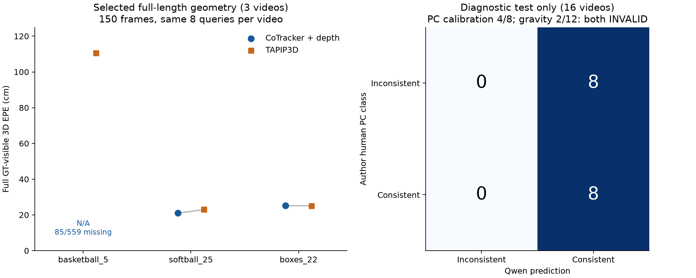

# Video physical consistency: measurement validity before generator ranking

Research report, 2026-11-17. This is an experimental closeout and paper draft, not a validated public leaderboard.

## 1. Introduction

Visual plausibility alone does not identify physical correctness. We implemented the October 16 proposal's two-part local evaluation and then tested the measurement and judging prerequisites exposed by its failures. The scientific question is whether generated videos support defensible physical estimates and calibrated judgments, with explicit coverage and abstention. The current results establish an executable framework and several failure boundaries; they do not establish a ranking of the generators.

## 2. Related work

The source papers below were rechecked on their primary arXiv pages. Existing benchmarks include open and commercial models, so the original proposal's blanket claim that this research fills an otherwise absent open-model niche is not retained.

| Study | Scope and metric approach | Model-access coverage and relation to this project |
|---|---|---|
| [Physics-IQ](https://arxiv.org/abs/2501.09038) | Physical-principle continuation tests with controlled reference outcomes | Includes open and commercial generators; motivates reference-based evaluation |
| [VideoPhy2](https://arxiv.org/abs/2503.06800) | Action-centric physical consistency; human PC labels and automated evaluation | Open and commercial models; public labels support our independent probe |
| [PhyGenBench](https://arxiv.org/abs/2410.05363) | Physical commonsense scenarios and structured multimodal evaluation | Evaluates multiple open and commercial systems; motivates task-specific evidence |
| [T2VPhysBench](https://arxiv.org/abs/2505.00337) | Physical-law-oriented text-to-video evaluation | Includes open and commercial models; not an exclusively closed-model benchmark |
| [Principia](https://arxiv.org/abs/2609.04200) | Controlled relational physical tests across eight phenomena | Relational measurement motivates our restricted two-object gravity test; we do not reproduce its complete benchmark |
| [Physical Law Perspective](https://arxiv.org/abs/2411.02385) | Quantitative tests of physical laws in generated videos | Supports separating numerical measurement from visual realism |

For measurement, [CoTracker3](https://arxiv.org/abs/2410.11831) provides point tracks, [TAPIP3D](https://arxiv.org/abs/2504.14717) provides native 3D point tracking, and [TAP-Vid](https://arxiv.org/abs/2211.03726) defines public tracking evaluation. Our official-metric DAVIS evaluation is distinct from generator physical accuracy. Depth Anything V2 and the authors' released tracking models are used as fixed inference baselines, not trained improvements.

## 3. Benchmark design and methods

Part A uses local Wan2.1-1.3B and CogVideoX-5B, four prompts per model and three seeds per prompt. Tracking precedes scale/time admissibility and fitting. Unavailable g/T estimates are missing, never zero error. Known-parameter procedural animations validate the scoped detector/fitter before generated-video evaluation. Those controls do not validate domain transfer.

Part B uses complex-scene prompts, uniformly sampled static frames, opaque identities, fixed JSON criteria and separate contexts. The original production judgments and calibration failure remain immutable. A prompt requesting a physical violation is not a verified positive label. Static frames cannot establish every intervening event. The former proposed Claude backend was not used for these runs: the original receipts document isolated GPT-family sessions; the new visual study uses a pinned local Qwen checkpoint. Generic paid API routes are not claimed to have been tested.

The November 17 protocol was frozen in [PROTOCOL.md](../research/proposal_completion_20261117/PROTOCOL.md) before scoring. We added fresh inference to the same CLI for all existing DAVIS videos and the same three PStudio examples, extending them from 64 to 150 frames with the same eight selected queries each. Each query runs independently; inference receives video, official initial queries and supplied intrinsics where applicable. Future truth is scored separately. CoTracker plus estimated depth and native TAPIP3D share depth/camera conventions. Invalid lifts are retained in the GT-visible, post-query denominator. Full EPE is unavailable if any required point is invalid; conditional finite/common-subset diagnostics are separate.

The new VideoPhy2 probe fixes 24 author-labeled source videos: 12 with human PC<=2 and 12 with PC>=4, hash-ordered within class. Four per class calibrate; eight per class evaluate. All planned source videos were obtained without replacement. Model names, captions and labels are withheld from judging. Qwen2.5-VL-7B-Instruct revision `cc594898137f460bfe9f0759e9844b3ce807cfb5` receives 32 evenly sampled source frames as two indexed montages and deterministic decoding. All calibration classifications must be correct. Evaluation continues diagnostically when this gate fails. This is neither the author's AutoEval reproduction nor a calibration of the old eight-frame Part B. The human label is PC only; SA and joint scores are not predicted here.

The same fixed Qwen model first judges 12 prior gravity controls, then the four existing native I2V videos in isolated contexts, with all-frame sheets and the previous applicability rubric. These are new AI opinions, not human labels. A separate three-color visual-channel probe checks that image input is functioning; it cannot validate temporal reasoning.

Video/scene is the experimental unit; frames, queries, encoding variants and reruns are dependent. DAVIS and the three PStudio clips were already exposed during prior development, so fresh inference is a reproduction/length extension, not unseen validation. The balanced human-PC test describes only its fixed sample. Its accuracy interval resamples caption clusters 10,000 times, seed 20261117. No p-values or population claims are appropriate for the three selected geometry examples. No training or optimization was done in this round.

## 4. Results

### 4.1 Part A and detector gate

| Model | Videos | Tracked | Valid complete fits | Mean g relative error | Mean T relative error |
|---|---:|---:|---:|---:|---:|
| cogvideox_5b | 12 | 5/12 | 0/12 | N/A | N/A |
| wan2.1_1.3b | 12 | 11/12 | 0/12 | N/A | N/A |

| Model | Prompt | Videos | Valid fits | g (m/s^2) | T (s) | Mean g relative error | Mean T relative error |
|---|---|---:|---:|---:|---:|---:|---:|
| cogvideox_5b | fall_a1 | 3 | 0/3 | N/A | N/A | N/A | N/A |
| cogvideox_5b | horiz_a4 | 3 | 0/3 | N/A | N/A | N/A | N/A |
| cogvideox_5b | pend_a3 | 3 | 0/3 | N/A | N/A | N/A | N/A |
| cogvideox_5b | proj_a2 | 3 | 0/3 | N/A | N/A | N/A | N/A |
| wan2.1_1.3b | fall_a1 | 3 | 0/3 | N/A | N/A | N/A | N/A |
| wan2.1_1.3b | horiz_a4 | 3 | 0/3 | N/A | N/A | N/A | N/A |
| wan2.1_1.3b | pend_a3 | 3 | 0/3 | N/A | N/A | N/A | N/A |
| wan2.1_1.3b | proj_a2 | 3 | 0/3 | N/A | N/A | N/A | N/A |

All 24 generated clips lack a valid complete physical fit. The g/T estimates and relative errors are unavailable; this is not zero physical correctness. Prompt types without g/T do not acquire invented values. Per-clip failure reasons are in the frozen [raw records](../benchmark/results/raw/part_a.jsonl).

| Synthetic condition | Parameter | Known value | Estimate | Relative error |
|---|---|---:|---:|---:|
| free_fall | g | 9.80000 | 9.80529 | 0.000540 |
| projectile | g | 9.80000 | 9.81588 | 0.001620 |
| projectile | v0x | 3.00000 | 3.00000 | 0.000000 |
| pendulum | T | 2.00709 | 2.00431 | 0.001384 |
| horizontal_motion | v0 | 2.00000 | 2.06565 | 0.032824 |
| horizontal_motion | decel | 0.50000 | 0.49928 | 0.001449 |

The synthetic detector/fitter gate is `True`. These numeric recoveries support only the known procedural conditions. Transfer to generated small/deformed targets remains unvalidated.

### 4.2 Original Part B

| Model | Judged production clips | Valid violation rate |
|---|---:|---|
| cogvideox_5b | 24 | N/A (invalid calibration) |
| wan2.1_1.3b | 24 | N/A (invalid calibration) |

| Model | Category | Valid violation count |
|---|---|---:|
| cogvideox_5b | rigid_body | N/A (invalid calibration) |
| wan2.1_1.3b | rigid_body | N/A (invalid calibration) |

Production judgments cover 48 clips; the original gate is `False`. All 8 generated controls were unverifiable as intended positives under that protocol. The [original leaderboard artifact](../research/part_b_20261113T114040Z/run/results/leaderboard/part_b_leaderboard.json) retains diagnostic counts, including categories, but no valid rates or ranking are reported. A new judge's result cannot retroactively repair those inputs.

### 4.3 Fresh labeled measurement runs

DAVIS: 30 videos, 650 queries; AJ 60.56%, APD 75.08%, OA 86.89%. Maximum coordinate difference from the frozen prior prediction is 0.0 pixels, with no visibility differences. This verifies adapter reproduction, not new generalization.

| Video (150 frames; 8 queries) | Co+depth full EPE (cm) | TAPIP3D full EPE (cm) | Co invalid / GT-visible point-times | Co / TAP common-subset EPE (cm) |
|---|---:|---:|---:|---:|
| basketball_5 | N/A | 110.60 | 85/559 | 73.59 / 87.73 |
| softball_25 | 21.00 | 22.97 | 0/636 | 21.00 / 22.97 |
| boxes_22 | 25.17 | 25.07 | 0/653 | 25.17 / 25.07 |

Across the three full-length PStudio examples, Co+depth misses 85/1848 required point-times. Its full macro EPE is N/A. Its finite-subset macro EPE of 39.92 cm must not be compared directly with TAPIP3D's full macro EPE of 52.88 cm. The final column uses identical common-valid points per video for descriptive comparison, while retaining the missing coverage separately. Offline full-sequence inference can change earlier predictions too; length extension alone does not identify the cause of any difference from the previous prefix experiment.

### 4.4 Independent local visual judging

Gravity calibration: 2/12 correct; valid=`False`. Both unequal-gravity violations were missed, and eight required abstentions were called PASS. The four I2V first replies (three PASS, one FAIL) therefore remain uncalibrated diagnostics. Their old numeric physical relations remain unmeasurable. Image-channel sanity checks passed all three colors, which only excludes a completely disconnected image channel.

Human-PC calibration: 4/8 correct; valid=`False`. Test: 8/16 correct, diagnostic accuracy 50.0%, caption-cluster bootstrap 95% interval [25.0%, 75.0%], 16 test caption clusters. All test clips were called consistent: TP=8, FP=8, FN=0, TN=0; missing/failed=0. This equals accepting every clip in the balanced test and supplies no evidence of useful physical discrimination. Here positive means physically consistent, so FP is false acceptance of a human-inconsistent clip, distinct from falsely accusing a consistent clip of violation. No valid generator ranking follows.

## 5. Discussion and limitations

The executable chain separates generation success, track existence, physical admissibility, numerical accuracy and calibrated judgment. Their distinction explains why no runtime errors and valid synthetic controls can coexist with failed scientific endpoints. Reappearance/identity filtering can raise precision through rejection; it must be assessed with retained coverage. Known-camera point geometry does not validate unknown-camera object-center relations in generated videos. Neither surface-point accuracy nor an assumed camera recovers SI physical constants without further evidence.

The Qwen results characterize this checkpoint, montage representation and frozen prompt. They do not establish that every VLM or video-conditioned judge fails. The human-PC sample deliberately selects extreme labels, excludes PC=3, is small and balanced, and cannot estimate production prevalence. Temporal montage resolution may lose evidence even when all source frames are represented. Existing generator clips still lack independent human physical labels; public point labels and author-provided PC labels support their own endpoints only. Procedural ground truth, human annotations, geometry ground truth and AI opinions remain separate.

Historical detector scale and multiscale experiments, identity recovery and confidence thresholds are indexed in the [November 16 summary](../docs/PROJECT_SUMMARY_2026-11-16.zh.md); no historical rerun is counted as new independent data. This work has not demonstrated a new general world model, a robust physical judge or a state-of-the-art tracking method.

## 6. Future work and conclusion

The next scientific prerequisites are verified positives/negatives with the same observed evidence as the judge, external small-target/identity validation with coverage, defensible camera/depth calibration, and human labels for this project's own generated clips. A redesigned judge or measurer must freeze a new protocol and use new validation examples. Generator expansion and constrained video fine-tuning remain conditional on these prerequisites; tuning on the failed test set would invalidate its future use as confirmation.

The conclusion is an experimentally supported measurement-validity failure, with a runnable baseline framework and explicit failure accounting. The original numerical-physics and calibrated-ranking objectives remain unmet. Experimental execution and a complete report do not turn failed gates into successful acceptance.

## Reproducibility, availability and AI assistance

Run commands and caveats are in [REPRODUCE.md](../research/proposal_completion_20261117/REPRODUCE.md). The final recorded test output is `117 passed in 8.29s`; exit=0. LSP analysis was unavailable because the configured server is not installed. A local copied-source/cache replay verifies only that stated scope, not a clean-machine neural reproduction. All first replies, frozen manifests, failed attempts, model hashes and runtime receipts are retained. Qwen weights are Apache-2.0; source videos retain their original rights, and a dataset-card license does not establish rights to redistribute every linked video. No new public upload was made. The old gingersea target is prohibited by current workstation instructions; local handoff is the reviewable deliverable.

AI assistance: GPT-family assistance was used for implementation, analysis and writing; Qwen supplied the explicitly uncalibrated visual opinions. A separate local GLM-family review is recorded with its actual coverage and [rulings](../research/proposal_completion_20261117/review/RULINGS.md): its broad output was truncated/repetitive and its bounded follow-up made unsupported allegations, so neither is claimed as a comprehensive independent pass. Scientific claims are based on saved inputs and computed outputs rather than model agreement.
