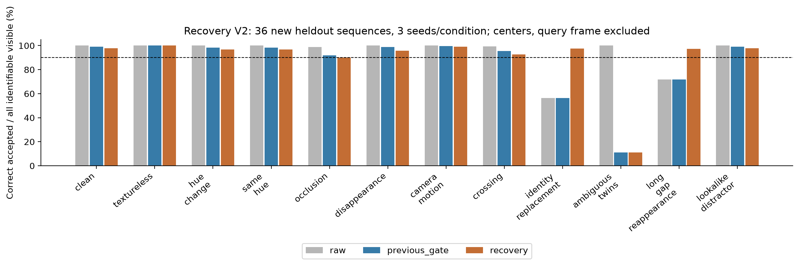
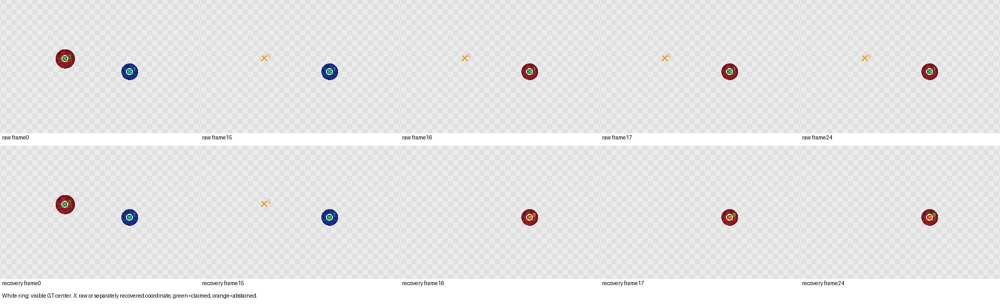
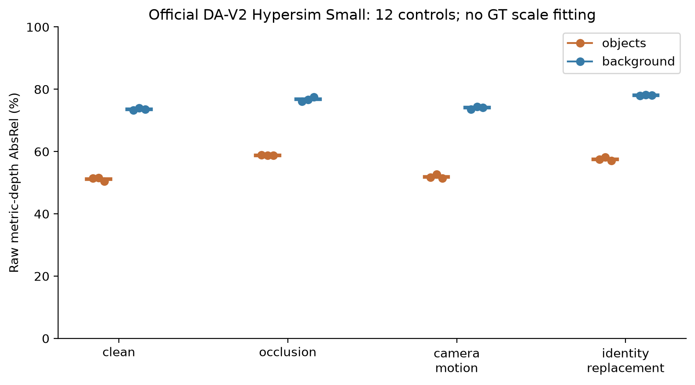
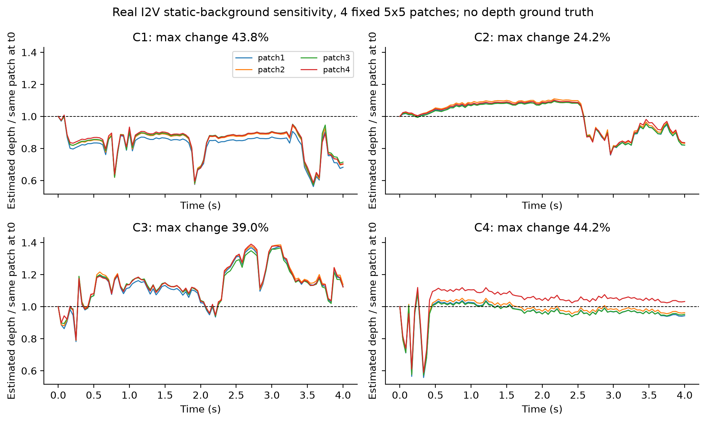

# 目标重现后的身份恢复与真实I2V估计深度链路

2026-11-15。本轮完成两轮身份恢复控制、真实I2V的独立AI视觉参考与人工标注包，以及实际运行的估计深度→完整TAPIP3D链路。**受控重现恢复已改善，真实I2V的测量门仍未通过，人工准确率验证未完成。**

## 1. 实验范围与可追溯设计

原始问题：旧独立门会拒绝错误位置，却不会重新找回在别处出现的原目标。先实现单独的恢复候选，在新控制上验证，之后应用于已有4段原生LTX I2V。全部原轨迹、旧研究和失败版本保持只读；恢复坐标另存，不写回模型预测。

V1与V2分别48段：12条件×4种子，其中12开发、36留出；两轮共96个不同视频。每段33帧、384×256、24FPS。原10种条件外增加长间隔异位重现和同外观干扰物；遮挡宽度、长间隔返回时刻随新种子变化。V2与此前118段控制无像素重复。每条件只有3个留出种子，实验单位为序列，逐帧、双对象、恢复事件是相关重复；不把数千帧当独立样本，不推断总体零假阳性，不作显著性检验或帧级置信区间。图、逐序列和逐事件数据保留全部结果。

主终点仍是两对象中心，排除查询第0帧。正确接受需身份可辨识、当前可见、定位误差≤3px。恢复事件定义为连续不可见≥2帧后，可见且可辨识≥2帧；返回后首次正确接受的延迟按帧计，未恢复事件不从分母删除。同形物体不可辨识后必须弃权；弃权不算覆盖通过。

## 2. V1失败、原因与独立V2验证

V1采用固定尺度初态灰度模板，全图唯一匹配并确认两帧。结果没有解决异位重现：留出恢复9/15事件，和旧门相同；正确接受保留率反而由92.34%降至78.23%。失败结果完整位于本目录 `control_results/`。

开发证据指出两个原因。第一，身份替换控制的原红色对象由3.8m移至4.4m平面，图像尺度缩小13.6%；固定尺度开发样本相关性约0.803，低于冻结的0.9阈值。第二，把全图唯一性要求用于一直得到局部支持的轨迹，会误拒绝无纹理对象和新出现的同外观干扰物。

因此单列 [V2协议](../identity_recovery_multiscale_20261115/PROTOCOL.md)，V1所有48段转为开发资料，另生成48段新纹理、新种子与新遮挡配置，不复用V1留出评分。V2在新推理前冻结，之后没有调参：

- 有当前局部外观证据、且位置连续的原候选保持身份；保留原坐标。
- 丢失或跳转后，使用不可更新的初态模板在0.75–1.25尺度范围检索；相关性≥0.9、竞争初始身份间隔≥0.15、第二空间候选差距≥0.08。
- 新位置需两连续当前帧确认，返回坐标明确标记 `global_reacquisition`。不读深度、未来真值、网络可见性或置信度。
- 灰度初态同形物体在可观测性丢失后仍锁为身份未知，不因重新出现一个相似团块而强行认领。

这借鉴了 [XMem](https://arxiv.org/html/2207.07115v2) 区分短期信息与持久身份记忆的思想；本实现是固定初态模板和局部时序支持，不是XMem网络或论文复现。多尺度检索不引入动力学先验，未按期待轨迹修正视频。

V2留出36段的2304个中心时刻，包含1905可见可辨识、273不可见可辨识、126不可辨识：

| 方法 | 正确接受/全部接受 | 正确保留率 | 假可见 | 错配另一对象 | 无依据身份声明 | 恢复事件 |
|---|---:|---:|---:|---:|---:|---:|
| 原生CoTracker3 | 1819/1924 | 95.49% | 83/273 | 83 | 22/126 | 9/15 |
| 上轮独立门 | 1772/1772 | 93.02% | 0/273 | 0 | 0/126 | 9/15 |
| 独立恢复V2 | **1825/1825** | **95.80%** | **0/273** | **0** | **0/126** | **15/15** |

假可见与错配可能重叠，不能相加。恢复延迟中位1帧、范围1–4帧；遮挡返回为3–4帧，身份替换与长间隔重现均为1帧。CoTracker是offline候选，包含整段上下文；因此不宣称整条系统是因果在线算法，恢复确认本身只按当前及过去图像处理。

| 关键条件 | 旧门正确保留率 | 恢复V2正确保留率 | V2恢复事件 |
|---|---:|---:|---:|
| identity_replacement | 56.41% | **97.44%** | 3/3 |
| long_gap_reappearance | 71.93% | **97.37%** | 3/3 |
| occlusion | 约92%（逐序列见JSON） | 90.12% | 3/3 |
| lookalike_distractor | 98.96% | 97.92% | 无预设消失事件 |
| ambiguous_twins | 11.11% | 11.11% | 不可辨识事件不强行恢复 |

11个可辨识条件的聚合正确保留率均≥90%，但不能忽略单序列失败：`occlusion_191201`为49/55（89.1%），`crossing_391201`为52/59（88.1%）。同形物体仍仅接受2/18个早期可辨识时刻，之后未知126次均弃权。当前结果支持“特定控制中恢复能力改善”，不支持全面生产升级。





白圈为可见真值中心；叉号为原始或单独恢复坐标。重现第16帧保留待确认状态，第17帧恢复原红色对象，同时拒绝把原蓝色身份绑定到红色对象。逐事件分母及延迟在 [V2事件表](../identity_recovery_multiscale_20261115/control_results/events.json)，逐序列和全部拒绝理由也保留。

## 3. 真实I2V独立参考：完成AI参考，人工仍待做

使用全部4段既有原生I2V，每段97帧、768×512，没有新生成或挑选成功视频。C1=B/43、C2=A/42、C3=B/42、C4=A/43。主助手先直接看原始RGB的0、12、24、…、96共36个预设帧，必要处看原尺寸图，写下 [AI视觉参考](real_i2v/ai_visual_reference.json)，之后才运行本轮真实视频的CoTracker、深度和TAPIP。每次模型收据绑定参考SHA256，模型不读取参考标签。

这不是完全未知视频盲试：既往定性报告已读；中心是从图像目测的近似值，位置不确定半径4–10px；变色后的C3身份对应也只根据采样空间连续性作暂定判断。C1接触、形变、半透明团块等明确保留身份未知，不强填中心。**AI参考不是人工真值，更不是生成视频的材料身份GT。** 用户已确认尚无人工标签，本轮先交付AI参考与人工标注包。

72条对象记录中，第0帧8条排除；剩64条为30可见且可辨识、20不可见、14未知。真实域只作名义8px中心诊断，同时报告参考位置不确定性上下界，不沿用受控真值的3px准确率说法。

| 真实I2V采样诊断 | CoTracker3 | TAPIP3D+估计深度 |
|---|---:|---:|
| 原生声明中落在AI中心8px内的已知可见点 | 22/30 | 17/30 |
| 计入参考位置不确定性后的对应范围 | 22–22/30 | 16–21/30 |
| 原生假可见声明（AI参考） | 2/20 | 0/20 |
| 原生声明未知身份（AI参考） | 6/14 | 5/14 |
| 旧门或恢复V2后的正确接受 | **2/30** | **2/30** |

不能用这张表给通用模型排名：样本仅4段且已见；参考不是真人；神经点查询是表面点，形变对象参考是外观中心，二者未必一致。未标注的其他帧不能据此宣布无错误，尤其不能把2/2接受精度写成可靠全覆盖。

域失败原因有直接证据，而非简单“无纹理”推测：8个初态灰度模板标准差均大于1；C1、C2、C4两个对象的初态灰度相关性分别0.979、0.988、0.956，已超过同形阈值0.95，虽然两对象RGB均值颜色距离超过211。灰度归一化抹掉了关键红蓝身份差异，失去一方支持后触发持续未知。C3则主要出现多空间候选竞争和缺乏唯一当前身份支持。详见 [外观拒绝诊断](real_depth_results/appearance_rejection_diagnosis.json)。没有用本轮4段视频反调门阈值。

可交给真人的 [人工标注包说明](real_i2v/ANNOTATION_GUIDE.zh.md)、[72条空CSV](real_i2v/human_annotation_template.csv)、原尺寸PNG和接触表均已完成。需要真人先独立看RGB、填可见性/身份/中心及不确定性，再与AI和轨迹比较；目前 `human_annotations_received=false`。

## 4. 估计深度与完整三维链路的结果

选择作者 [Depth Anything V2的Hypersim Small度量模型](https://github.com/DepthAnything/Depth-Anything-V2/blob/a561b849ebae10a6f5ef49e26c83cbbcd36c71bf/metric_depth/README.md)，代码固定 `a561b849ebae10a6f5ef49e26c83cbbcd36c71bf`，HF模型revision `3bc65d4e14a6786a61acec16453c50e12bf5f338`，权重SHA256 `b782898d8a3e8be1f639de33837ed85e9b4b73e40f8f5e5cd99067588d722545`。原生 `infer_image`、输入518、max_depth20、FP32，没有逐帧GT尺度拟合。

实际完成12段已知几何控制（每段33帧）和4段真实I2V（每段97帧），共784帧深度推理。12控制来自V1，不再充当新身份恢复的未见集；深度诊断未据这些分数选择更优模型或调阈值。全部深度有限、正值，这仅证明运行接口成立。

### 已知几何：二维匹配改善仍可伴随错误尺度

对象区域原始深度AbsRel约50.5%–59.0%，背景约73.2%–78.2%；对象深度中位预测/真值比仅0.400–0.500。未用真实I2V未知深度伪造尺度标定，也未将这里的GT对齐结果冒充原生输出。



随后在同12控制上实际运行完整作者TAPIP3D，使用估计深度、准确控制内外参、相同初始查询、6迭代及6×6支持网格。与CoTracker3+同一估计深度比较；初始查询三维坐标也来自估计深度，不偷用目标GT。664个可见可辨识中心时刻的结果：

| 全分母终点 | CoTracker3+估计深度 | 完整TAPIP3D+估计深度 |
|---|---:|---:|
| 二维PCK≤3px | 613/664 | **663/664** |
| 平均世界三维误差（原尺度） | 2.427m | 2.417m |
| 三维PCK≤5cm | **0/664** | **0/664** |

TAPIP此条件下恢复了不少二维对应，但原生可见性仍有36次假可见、35次错配另一对象。**高二维投影准确率、真实模型推理和低重投影残差均不能证明三维尺度正确。** 这也说明模型效果依赖几何输入，不能把上一轮准确深度条件的结论直接搬到估计深度条件。上述是小型程序化域诊断，不是官方benchmark排名。

### 真实I2V：估计深度运行通了，度量证据仍不足

真实4段也已实际运行完整TAPIP3D，而非只给二维点乘深度。由于没有独立相机标定，显式假设静态单位外参、焦距等于图宽768px、主点居中。输出命名为 `xyz_assumed_camera`，不是经验证的真实世界坐标；未运行相机位姿估计或声称MegaSaM前端完成。初态三维查询仅从预测深度反投影。

选4个固定5×5背景小块。它们的RGB相对初态MAE仅0.109–0.136/255，估计深度却明显变化：

| 视频 | 背景深度CV均值 | 相对初态最大变化 |
|---|---:|---:|
| C1 | 10.26% | 43.80% |
| C2 | 9.57% | 24.19% |
| C3 | 10.31% | 39.02% |
| C4 | 8.27% | 44.25% |



这些不是深度GT误差，也不能排除极微小生成变化或相机假设问题，但不足以支持稳定米制度量。回投影与保存二维输出数值一致仅作为接口检查；它是构造的代数关系，绝不列为3D准确性验证。没有据此计算重力、接触关系或物理leaderboard。

## 5. 失败、软件验证、复现与交付

V1固定尺度的科学失败完整保留，没有覆盖成V2。首次资料复用缺少导入搜索路径，在任何数据生成前失败，修正路径后保留原日志与before源。Depth模型初次因xFormers在SM120不支持FP32注意力而失败；保留 `estimated_depth/clean_19101.json` 和原错误日志，随后只选择作者已有普通PyTorch注意力回退，模型权重与作者源码不变，输出另存 `estimated_depth_native_attention/`。TAPIP仍使用固定官方CoTracker构造依赖，最终362个状态张量逐一与作者检查点相等。

pointops旧式CUDA Tensor构造器警告保留；没有隐藏报错或把接口失败当成功样本。basedpyright/biome依此前偏好未安装，未声称LSP通过。没有新依赖安装、付费API、生成扩样或公开上传。

软件：Python3.12.3、Torch2.9.0+cu128、CUDA12.8、两张RTX5090；沿用上一轮隔离环境。83项仓库测试通过；V1行为/事件/参考/新数据验证7项和V2行为3项通过，共10项研究测试。审计绑定96次控制CoTracker、8次真实视频模型推理、12次控制估计深度TAPIP及16段784帧深度；验证旧依赖、冻结参数、输入/检查点/输出哈希及参考早于模型输出。见 [verification.json](verification.json) 和原日志。

实际核心入口（项目根；已有输出拒绝覆盖，重做需新研究副本/目录）：

```bash
PY=/data/AI_Research/shared/observation_gate_20261115/env/bin/python
$PY research/identity_recovery_20261115/prepare.py
$PY research/identity_recovery_20261115/run_cotracker.py --gpu 0
$PY research/identity_recovery_20261115/assess_controls.py
$PY research/identity_recovery_multiscale_20261115/prepare.py
$PY research/identity_recovery_multiscale_20261115/freeze.py before_inference
$PY research/identity_recovery_multiscale_20261115/run_cotracker.py --gpu 0
$PY research/identity_recovery_multiscale_20261115/assess.py
$PY research/identity_recovery_20261115/run_depth.py --gpu 1
$PY research/identity_recovery_20261115/run_real.py --model cotracker --gpu 0
$PY research/identity_recovery_20261115/run_real.py --model tapip3d --gpu 1
$PY research/identity_recovery_20261115/controlled_estimated_tracking.py
$PY research/identity_recovery_20261115/assess_real_depth.py
$PY research/identity_recovery_20261115/appearance_diagnosis.py
$PY research/identity_recovery_20261115/figures.py
$PY research/identity_recovery_20261115/audit.py
```

顺序说明：AI视觉参考先于真实模型运行；V1失败后才立V2协议和全新留出集；以上压缩入口不重演人工目视、原失败和全部源码冻结，完整日志/快照保留。两个同名test_recovery.py属于不同研究，应分别运行，避免Python导入缓存混淆。PNG/PDF/SVG、全部深度数组、逐序列/逐事件/逐点诊断、原始参考和空人工CSV均保存；本地版本化交付和复制后分析复算范围见 `handoff_receipt.json`、`reproduction_receipt.json`。

## 6. 结论与下一项可验证工作

本轮把“只会拒绝”推进到“能在新的受控异位/尺度变化后恢复”：身份替换56.4%→97.4%，15/15事件恢复，同时保留不可辨识弃权。该增益可复核，但没有跨过真实生成视频的身份/中心观测门。

下一步应针对真实域的失败机制，比较保留颜色、轮廓与持续实例证据的表示，明确区分表面查询点和对象中心；设计新的外观/形变控制，不能在已看过的4段上调到成功后声称未见验证。人工标注待实际评阅人填写后再量化真实域准确率。深度需先解决时序尺度与独立标定问题，再谈世界运动；不继续用重投影一致或二维PCK作为三维度量已通过的证据。
