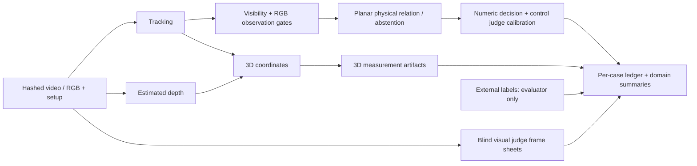

# Integrated measurement framework

Run from the repository root with the existing isolated environment. No model
download or additional training is required. The manifest binds every input,
cached prediction and frozen scoring source to SHA256.

```bash
PYTHONPATH=benchmark /data/AI_Research/shared/paper_benchmark_20261115/env/bin/python \
  -m physcheck.relations \
  --manifest research/integrated_framework_20261115/manifest.json \
  --output /tmp/physcheck-replay-new

PYTHONPATH=benchmark /data/AI_Research/shared/paper_benchmark_20261115/env/bin/python \
  -m physcheck.relations \
  --manifest research/integrated_framework_20261115/manifest.json \
  --output /tmp/physcheck-fresh-new --domain i2v --fresh-i2v --gpu 1
```

Use new output paths; existing directories are never overwritten. Replay uses
frozen learned predictions and recomputes decoding/observation gates, lifting,
relations, calibration checks and label scoring. Fresh I2V runs all three native
networks (CoTracker3, Depth Anything V2 and TAPIP3D) from stored RGB. It uses the
same fixed 10 queries, assumed camera, weights and parameters as the previous
I2V study. Public DAVIS/PStudio predictions are reused, not newly inferred.



The controlled gravity relation uses frozen RGB object centers, not arbitrary
learned surface points. Its metric is dimensionless and does not require depth.
For 3D, the framework preserves native TAPIP3D coordinates and separately lifts
CoTracker coordinates with estimated depth. Out-of-image positions are marked
invalid; clamping does not turn them into valid measured points. Assumed camera
coordinates in generated clips are not validated metric world coordinates.

Outputs include summary.json, cases.json, events.jsonl, run_receipt.json and a
short REPORT.md. Each case has result.json and normalized tracks.npz; fresh I2V
adds fresh_predictions.npz and fresh_inference.json. All-frame RGB sheets and
an opaque visual_judge_payload.json are exported without predictions/GT/model
identity. Their visual judgment status stays pending. The numeric relation
decision remains available and may legitimately be ABSTAIN.

Stage statuses distinguish executed/reused/not_applicable. Per-case errors remain
in cases.json and make the CLI exit nonzero. Global model initialization errors
produce an error for every affected I2V case without silently using cached
predictions. Relation verdicts distinguish PASS/FAIL/ABSTAIN/NOT_APPLICABLE.
Different data domains are summarized separately, never combined into one model
ranking. Existing 12 independent control judgments are revalidated; no new visual
judge session or missing human label is invented.

To import evidence-bound visual observations, add `--visual-judgments FILE.json`
with a JSON array using the schema in `relations/visual.py`. Each record binds the
opaque ID, payload SHA256 and full ordered viewed-sheet SHA256 list, an observed
verdict/reason, event ranges, assumptions and provenance. Duplicate or unknown IDs
are rejected; incorrect payload/image hashes and conclusive opinions lacking
event/admissibility evidence are rejected. Imported opinions enter a separate
diagnostic channel and never replace numeric measurements or reference labels.
Content validation cannot certify blinding/human origin: independent validation
stays pending even when an imported diagnostic opinion passes schema checks.
Missing opinions stay pending. The full control matrix also supports controls
without a visual judgment; their numeric relation and evaluator run normally.

The dated study report records the actual runs and scientific limits:
research/integrated_framework_20261115/REPORT.zh.md.
