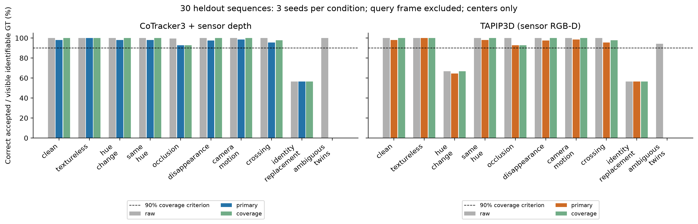
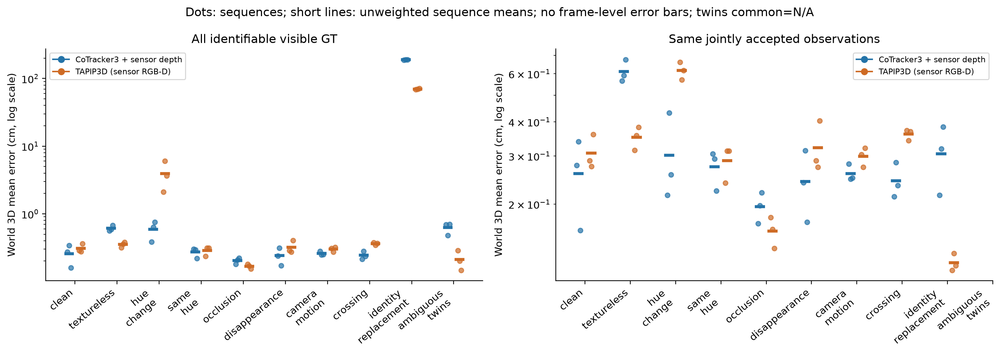
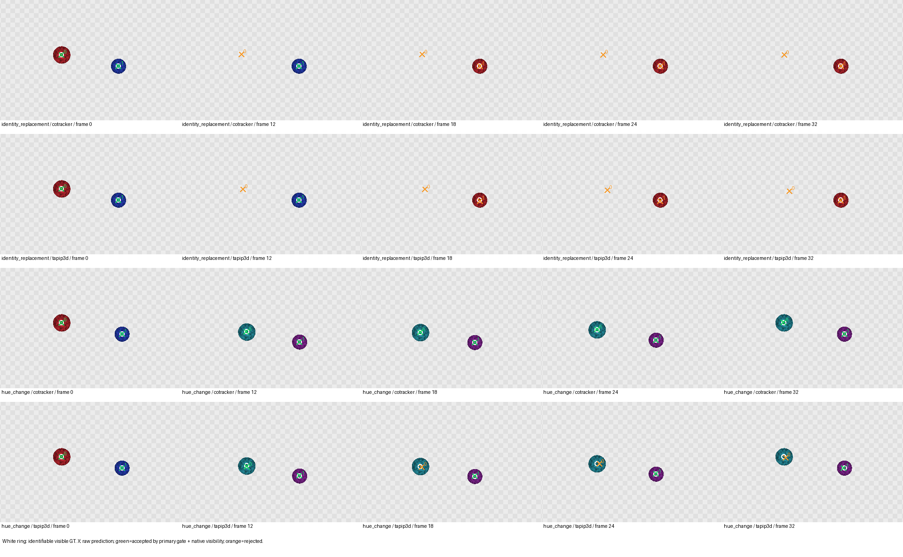

# 独立身份/遮挡观测门与完整 TAPIP3D 配对实验

日期：2026-11-15。研究问题：独立图像证据能否阻止点跟踪器在身份替换、遮挡和不可辨识历史下作出错误声明？在相同视频和查询上，完整学习式三维跟踪是否进一步改善对应与测量？

本轮完成了独立观测门、新控制集留出验证，以及**实际作者 TAPIP3D 模型**与 CoTracker3 的配对运行。每种模型40段、1320帧，合计80次成功推理。严格观测门在留出集未接受错误观测，但身份替换恢复仍不合格。TAPIP3D 降低了全分母三维平均误差，却没有在双方共同接受点上胜过二维加深度基线，也没有解决身份恢复。因此暂不升级生产物理评分。

## 1. 设计、数据和方法边界

先在旧 `tracking_validation_20261115` 的全部30段已见资料上开发、校准；旧留出集明确退役为开发资料。随后生成40段新控制：10种条件×4个新种子（810开发；1810、2810、3810留出），每段33帧、384×256、24FPS。新材料纹理按种子、对象独立随机；同形双物体使用相同纹理。40个视频像素哈希互异，与旧30段无重复。新旧数据和失败记录全部保留。

这是程序化受控验证。几何为固定深度平面圆片，背景和遮挡面具有准确深度，摄像机仅平移；外观用明暗表现圆形对象，不能称为真实球面重建。没有新生成视频或人工标注。本轮没有把旧4段原生I2V的测量问题宣布解决。

实验单位为序列；两个对象中心是主终点，10个材料点为辅助终点。排除用于初始化的第0帧。30段留出序列产生1920个中心时刻：1603可见且身份可辨识、191不可见且身份可辨识、126身份不可辨识。帧与查询是相关重复测量；每条件仅3个新种子，不作为1920个独立重复，不据此推断总体假阳性率，不报告帧级P值或独立二项置信区间。图展示逐序列点；本轮只作描述性配对比较，无显著性检验或多重比较声明。

**独立门的输入**只有初始RGB模板、初始中心与已知初始半径、当前RGB和跟踪器提出的中心；不读未来真值、深度、网络可见性或置信度。检查灰度归一化模板匹配、当前位置3px邻域支持、竞争初始身份和更强全局匹配。初态近乎相同的对象一旦丢失外观证据或接近，进入持续身份未知状态。门只接受/拒绝，**不移动预测坐标，也不负责重新找回丢失目标**。最终声明为独立门与原生可见性的交集；门单独输出也完整保留。

这是固定尺度、近正面模板证据，不是通用重识别或独立学习式遮挡分割。拒绝原因能说明缺乏当前证据，不能仅由拒绝判定具体遮挡机制。尺度、旋转、形变和自然视频外观变化尚未验证。

## 2. 先校准再留出验证

旧30段资料扫描12组固定参数。严格主配置为模板半径比例0.5、相关性阈值0.9、身份间隔0.15；按最小错误及无依据声明、再最大正确保留选择。旧资料上正确接受683、错误1，正确保留率42.6%。预设次配置在开发接受精度≥99%、无无依据身份声明的约束下最大化保留：0.5/0.8/0.15，正确1424、错误5，保留率88.8%。两配置均在新模型推理前冻结，之后没有按留出得分改参数或逐条件挑配置。

来源：[PROTOCOL.md](PROTOCOL.md)、[开发网格](calibration/grid.json)、[冻结参数](gate_operating_points.json)、[推理前哈希](pre_inference_freeze.json)。模板家族和纹理分布变化后，新留出集更容易匹配，旧新保留率差异不能解释为自然视频泛化能力提升。

以下“联合接受精度”要求身份可辨识、真值可见且定位误差≤3px；无依据身份声明同样计入不正确接受。保留率分母始终为全部1603个可见可辨识时刻。

| 模型与规则 | 接受数 | 正确接受/接受 | 正确保留率 | 假可见 | 错配另一中心 | 无依据身份声明 |
|---|---:|---:|---:|---:|---:|---:|
| CoTracker3 原生 | 1624 | 1551/1624（95.50%） | 96.76% | 52/191 | 51 | 21/126 |
| CoTracker3 + 严格门 | 1496 | 1496/1496 | 93.33% | 0/191 | 0 | 0/126 |
| CoTracker3 + 次配置 | 1519 | 1519/1519 | 94.76% | 0/191 | 0 | 0/126 |
| TAPIP3D 原生 | 1566 | 1487/1566（94.96%） | 92.76% | 53/191 | 51 | 23/126 |
| TAPIP3D + 严格门 | 1432 | 1432/1432 | 89.33% | 0/191 | 0 | 0/126 |
| TAPIP3D + 次配置 | 1455 | 1455/1455 | 90.77% | 0/191 | 0 | 0/126 |

假可见与错配可以重叠，不能相加当独立错误。零次错误是这批控制上的观测，不是已证明总体错误率为零。独立门单独使用时：CoTracker严格1496/1496正确，TAPIP严格1436/1436正确；TAPIP次配置1459/1460正确。原生可见性与独立门交集去掉了后者那一次错误；没有把网络分数当作门的输入。



严格门的逐条件正确保留率：

| 条件 | CoTracker3 | TAPIP3D |
|---|---:|---:|
| clean | 97.92% | 97.92% |
| textureless | 100% | 100% |
| hue_change | 97.92% | 64.58% |
| same_hue | 97.92% | 97.92% |
| occlusion | 92.81% | 92.81% |
| disappearance | 97.58% | 97.58% |
| camera_motion | 98.44% | 98.44% |
| crossing | 95.48% | 95.48% |
| identity_replacement | **56.41%** | **56.41%** |
| ambiguous_twins | **0%** | **0%** |

身份替换条件中，两模型都将原蓝色查询继续附着到新出现的红色对象；门挡住了51次假可见/错配，但原红色查询没有恢复到新位置，所以仍只保留66/117个正确可见时刻。拒绝错误不等于恢复跟踪。CoTracker在9种可辨识控制中8种满足≥90%保留，TAPIP仅7种；后者颜色变化的3段留出序列均低于90%。

同形双物体在遮挡后物理身份不可从图像确定，持续弃权符合未知处理要求；但当前固定模板门也拒绝了其17个仍可辨识的早期可见时刻，因此该条件不能写为“可靠覆盖通过”，联合接受精度为N/A。

## 3. 完整三维模型比较的实际结果

[TAPIP3D论文](https://arxiv.org/abs/2504.14717)采用相机稳定的时空三维特征云与邻域注意力。本轮运行其作者完整学习模型和原生pointops CUDA算子，不是上一轮的坐标升维诊断。按照[作者项目的传感器深度对照](https://tapip3d.github.io/)，比较对象为 CoTracker3 + 同一场景深度/相机，以及 TAPIP3D RGB-D。

两者相同原始视频、10个初始查询、6次迭代和6×6支持网格、FP32。CoTracker保留作者原生内部384×512分辨率，TAPIP使用256×384；这是明确的原生设置差异，不声称架构以外因素完全匹配。TAPIP raw模式输出世界坐标，查询3D仅从第0帧像素与输入深度反投影。CoTracker在自己预测的像素取最近邻场景深度，并用同一相机变换到世界坐标；没有从未来真值取目标深度。

**深度和相机来自受控渲染器的准确传感器输入**，而非单目估计。没有运行MegaSaM/MoGe重建前端；该比较不回答真实I2V无深度时端到端能否改善，也不复现论文官方基准排名。5cm阈值是本轮辅助描述尺度，非TAPVid-3D官方指标。

| 留出中心终点 | CoTracker3 + 已知深度/相机 | 完整 TAPIP3D RGB-D |
|---|---:|---:|
| 全部可见可辨识点二维PCK≤3px | 96.82% | 93.14% |
| 全部可见可辨识点平均二维误差 | 4.228px | 4.299px |
| 全部可见可辨识点平均三维误差 | 14.169cm | 5.820cm |
| 全部可见可辨识点三维PCK≤5cm | 96.82% | 93.64% |
| 各自严格门接受点平均三维误差 | 0.341cm（1496点） | 0.320cm（1432点） |
| **双方共同接受的1432点平均三维误差** | **0.304cm** | **0.320cm** |

全分母三维均值改善约58.9%，主要来自身份恢复失败条件的长尾减轻：该条件CoTracker升维误差189.77cm，TAPIP69.99cm，但两者正确接受保留率同为56.41%。二维错对应采到背景深度，会放大CoTracker的三维误差；学习式3D能减轻这种数值放大，却不代表身份对应已恢复。TAPIP的三维PCK反而更低；颜色变化条件三维均值由CoTracker的0.59cm升到3.92cm。

各自接受子集的0.341/0.320cm不能直接证明TAPIP更优，因为样本不同；共同接受子集0.304/0.320cm消除了这一选择差异，本轮没有观测到TAPIP优势。未接受时刻仍保留在全分母误差/PCK和覆盖指标内，失败条件未被剔除。



散点是3个序列，短线为序列均值；两面板明确使用各自对数量程。右侧同形双物体无共同接受点，N/A，不补零。汇总表按可见点加权，图按序列展示；两者的汇总方式有意区分。

10材料查询的辅助原生二维PCK为CoTracker 7766/8021、TAPIP 7481/8021；完整记录见 [auxiliary_all10.json](comparison/auxiliary_all10.json)。观测门主结论只适用于两个中心，未把中心接受自动传播为所有材料点的身份正确性。



白圈为可见且可辨识真值；叉号为原始预测，绿色表示通过严格门与原生可见性，橙色表示拒绝。初始化帧仅供检查，不进入评分。

## 4. 真实性、失败历史与可重复性

CoTracker作者代码固定于 `82e02e8029753ad4ef13cf06be7f4fc5facdda4d`，检查点SHA256 `2670d4562ed69326dda775a26e54883925cd11b6fc9b24cb7aa9f8078bce7834`。

TAPIP作者代码固定于 `4cb7e69a1687f67d56ec3e506768f51f2c581b46`，模型仓库revision `08730a588204f258f7a86530df15b2a6426e5f5b`，检查点SHA256 `3a9514d526559838e6158360af2b857da596d064b06a94fae7fd3b85134b2b1e`。每次收据绑定输入、源码、检查点、运行器和输出哈希；TAPIP最终362个状态张量逐一与检查点完全相等。

隔离环境使用Python3.12.3、Torch2.9.0+cu128、CUDA12.8、两张RTX5090。只新增hydra-core1.3.2、python-box7.3.2和作者原生pointops2；基础PyTorch环境未更改。其余版本见 [verification.json](verification.json)。

实际遇到且保留的工程问题包括公开源码下载SSL失败、pip超时、pointops包别名缺失，以及作者构造器试图下载CoTracker可变main分支。最后一项在任何视频推理前中断，改为本地固定官方依赖后重新加载；严格核对全部最终模型权重，未改作者模型源码、原生内核或门参数。细节及before/after在 [ENGINEERING_CORRECTIONS.md](ENGINEERING_CORRECTIONS.md)。

仍存在作者原生CUDA代码的旧式 `torch.cuda.*Tensor` 构造器警告，以及编译器对CUDA12.8缺少版本边界资料的提示；不影响本次编译/推理通过，原文在日志中保留。图例布局修订为figures_v3，v1/v2保留且数值完全相同。basedpyright按此前偏好未安装，未声称通过LSP。

验证：观测/指标6项测试通过；仓库原测试83项通过。端到端审计确认80次成功推理、40个无重复新视频、门/协议/输入冻结不变、旧8个源码和4个旧基线文件不变、作者34+129个文件及检查点校验通过。GT像素与深度反投影最大误差4.92×10⁻⁷m，TAPIP回投影误差3.05×10⁻⁵px，初始3D查询误差3.58×10⁻⁷m。软件验证通过不等于生产科学门通过。

主要数据：`data_manifest.json`、`predictions/`、`gate_validation/`、[逐序列中心指标](comparison/case_metrics.json)、[汇总CSV](comparison/summary.csv)、`comparison/*_gate.json`和`*_masks.npz`。PNG/PDF/SVG图在 `figures_v3/`，保留作图源及逐序列点。

核心实际运行入口（项目根目录）：

```bash
PY=/data/AI_Research/shared/observation_gate_20261115/env/bin/python
$PY research/observation_gate_20261115/calibrate.py
$PY research/observation_gate_20261115/new_controls.py
$PY research/observation_gate_20261115/prepare_run.py
$PY research/observation_gate_20261115/run_model.py --model cotracker --gpu 0
$PY research/observation_gate_20261115/evaluate.py --models cotracker --output gate_validation
$PY research/observation_gate_20261115/run_model.py --model tapip3d --gpu 1
$PY research/observation_gate_20261115/evaluate.py --models cotracker tapip3d --output comparison
$PY research/observation_gate_20261115/present.py --figures figures_v3
$PY research/observation_gate_20261115/audit_artifacts.py
$PY -m pytest -q -p no:cacheprovider research/observation_gate_20261115/test_gate.py research/observation_gate_20261115/test_evaluate.py
```

这些入口为实际流水线说明，已有数据/预测/结果目录会拒绝覆盖。重做须使用新研究副本；单模型复核可用新的 `--run-name`、`--only clean_810`，聚合用新 `--output`。作者资产准备入口 `fetch_tapip.py`、`fetch_environment.py`与pointops编译日志均保留。本地共享交付路径、复制校验与复核范围见 `handoff_receipt.json`。

## 5. 当前决策与下一步

本轮完成“补独立身份/遮挡观测门并验证，再推进一次完整三维模型配对实验”。观测门可有效挡住本组明显错误，但完整生产门仍失败：身份替换后恢复不足，同形物体过早弃权，TAPIP另有颜色变化覆盖损失。保留CoTracker3加独立门作为后续受控基线，不依据全分母三维均值替换为TAPIP。

下一项优先验证重现目标后的候选重检与身份恢复；显式区分“当前无证据”“可辨识但跟丢”“物理身份不可辨识”。任何新恢复策略需新的留出种子、纹理和遮挡配置，当前40段随开发使用后不能继续叫未见验证。随后在旧4段原生I2V建立独立身份、可见性与中心位置的标注评估，再引入估计深度/相机与已知几何对照。真实人工标签仍缺，不能用程序化标签或模型输出冒充。

本轮只比较一个完整学习式三维架构与二维加深度基线；更多三维模型、多视角/单目重建前端、真实I2V跨域、生产Part B校准、人类标签和物理leaderboard仍未被自动完成。没有扩大生成或公开上传研究材料。
