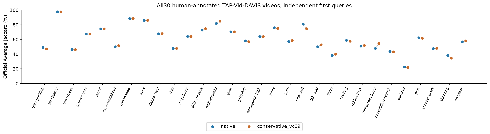
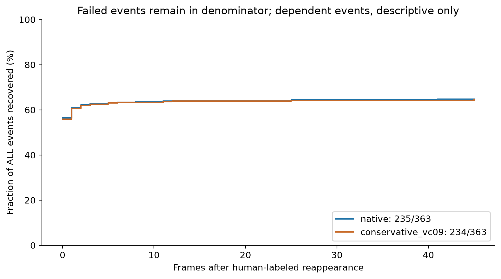
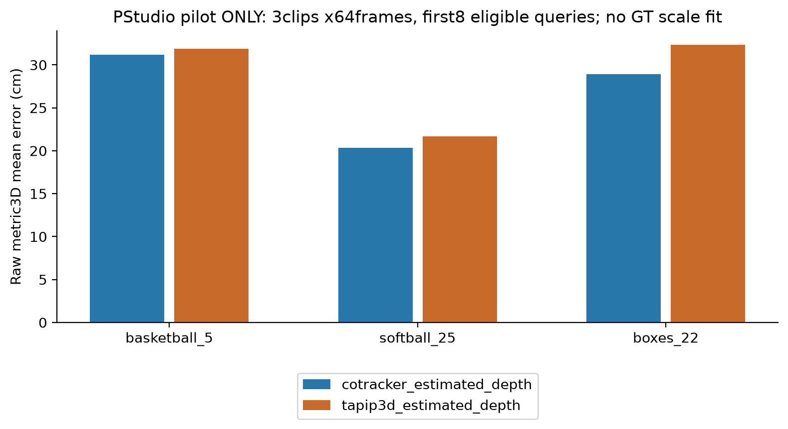

# 用论文公开标注素材验证跟踪与三维测量链路

2026-11-15。按用户建议，已实际使用论文实验的现成标注素材，不再以本研究AI视觉参考作为主要真值。完成官方TAP-Vid-DAVIS全部30段、1999帧、650条人工检查轨迹的逐查询测试；另完成3个TAPVid-3D/PStudio标定几何样例的有限三维小试。

结论：公开标注素材能够直接提供可靠的测量对照。当前CoTracker3基线仍有遮挡恢复和错误可见声明，固定置信门只带来取舍；估计深度的完整TAPIP3D链路在3个几何样例中也没有显示优势。没有把公开自然视频基准通过等同于自制I2V物理测量通过。

## 1. 素材与标注来源

| 来源 | 现有标签 | 本轮用途与边界 |
|---|---|---|
| [官方TAP-Vid-DAVIS](https://github.com/google-deepmind/tapnet/blob/ceedd60bb9f6c9f7c74796e4445aff6c6ddf7c9b/tapnet/tapvid/README.md) | 30段视频的表面点轨迹、遮挡；光流辅助插值后人工检查 | 完整二维跟踪/遮挡/重现基准；不提供球心、深度或物理关系GT |
| [官方TAPVid-3D/PStudio素材](https://github.com/google-deepmind/tapnet/blob/ceedd60bb9f6c9f7c74796e4445aff6c6ddf7c9b/tapnet/tapvid3d/colab/load_and_visualize_tapvid3d_samples.ipynb) | 校准相机与3D轨迹/可见性，来自标定几何处理 | 3段受限前缀小试；不称纯人工深度标注或完整3D benchmark |
| [Principia当前公开数据](https://github.com/PrincipiaBench/Principia) | 首帧与对象初始点、场景参数 | 可作生成条件；不能替代逐帧轨迹人工GT |

TAP-Vid标注并非每帧从零手点，人工会检查光流辅助的插值轨迹；这一来源比本研究的单次AI目测参考更适合验证定位与遮挡，但不是无误差的物理测量标定。视频权利归原作者，官方原始README/SOURCES与下载收据保留，未公开重分发。

官方DAVIS原包固定generation `1671476530685857`，大小1668710491字节，MD5 `a7e786a1a5d26ba941b7c10bed21c20e`；本轮SHA256为 `60eb6239c57a9877900c269d14637c2b6eece8fa280f59e4592324c6392031b6`。原始包和完整原始pickle保存在 `/data/AI_Research/shared/paper_benchmark_20261115/`，原始与派生文件分开保存。旧所有实验保持只读。

## 2. 冻结协议与模型

先写 [PROTOCOL.md](PROTOCOL.md) 和 [补充分析计划](ANALYSIS_PLAN.md)，再生成全部30段模型输入/外部真值；本轮没有按得分排除视频、改变阈值或挑成功案例。官方代码固定于 `ceedd60bb9f6c9f7c74796e4445aff6c6ddf7c9b`。`compute_tapvid_metrics` 和 `sample_queries_first` 函数体原样提取为NumPy模块，原始源文件完整保留；逐字比对和测试通过。没有为适应模型改评分公式。

使用官方first查询：每条轨迹只给第一次可见时刻的一个点。RGB按官方mediapy接口缩放到256×256，归一化轨迹乘256；输入查询与未来位置/遮挡标签分文件保存。官方first评分排除查询帧及之前帧。650个查询各自独立推理，使用固定6×6作者支持网格，避免其他人工标注查询影响本查询。CoTracker是offline模型，允许读取整段RGB，不宣称因果在线。

CoTracker3为此前已固定的官方offline模型：代码revision `82e02e8029753ad4ef13cf06be7f4fc5facdda4d`，权重SHA256 `2670d4562ed69326dda775a26e54883925cd11b6fc9b24cb7aa9f8078bce7834`；FP32、6迭代、window60、原生内部384×512处理、无反向补轨。没有训练或模型质量重试。

主方法为原生可见性；预先固定的辅助方法为之前的 `visibility*confidence>0.9`，只改变声明、不改变坐标。它仍是网络分数规则，**不是独立身份证据或已校准的身份概率**。当前任意表面点没有对象半径/对象列表，不能硬套此前的双对象竞争身份门；本轮没有据此宣称旧门得到完整人工验证。

## 3. 完整30段人工标注基准结果

官方指标按每段计算后，对30段等权平均。AJ结合定位与遮挡，APD平均1/2/4/8/16px阈值下可见点定位比例，OA为遮挡准确率。以下为百分制；这是本配置的发布模型实测，不是宣称精确复现论文表格或模型排名。

| 声明规则 | AJ | APD平均 | OA |
|---|---:|---:|---:|
| 原生可见性 | **60.56** | **75.08** | **86.89** |
| 固定v*c>0.9 | 60.74 | 75.08 | 84.76 |



每个点为一段，连线连接同视频两规则，坐标与其他条件相同。APD相同是坐标未改变的预期结果，不是两次模型独立实验。

补充计数使用明确不同的汇总方式：38231个查询后点时刻，其中28174可见、10057不可见；它们相互相关，不能当38231个独立实验。

| 补充点时刻终点（4px） | 原生 | v*c>0.9 |
|---|---:|---:|
| 可见声明数 | 25072 | 23702 |
| 正确可见且定位<4px的声明 | 21096 | 20734 |
| 接受精度 | 84.14% | 87.48% |
| 可见GT上的正确接受保留率 | 74.88% | 73.59% |
| 假可见声明 | 1149/10057（11.42%） | 912/10057（9.07%） |
| 重现事件恢复 | 235/363（64.74%） | 234/363（64.46%） |

辅助门减少237次假可见（减少20.6%），也损失362次正确接受；因此不是无代价提升。30段成对序列bootstrap（10000次，seed20261115）的描述性AJ差为+0.175个百分点，95%百分位区间[-0.583,+0.947]；OA差为-2.130个百分点，区间[-3.194,-1.183]。这些区间仅描述本数据混合的序列变异，不作生成视频域或普遍因果推断，不报告帧级P值。

重现事件预先定义为连续遮挡≥2帧后连续可见≥2帧；返回可见区间内第一次正确声明且误差<4px即恢复。失败事件不从分母删除。原生有128/363次未恢复；辅助门有129/363次未恢复。已恢复事件延迟中位均0帧，但最长分别41/45帧，不能只看中位值忽略失败和长尾。



逐序列、全部事件、原始模型visibility/confidence与固定门结果在 [results/](results/) 和 `predictions/`，未只保留汇总分数。

## 4. 现成标定3D素材的有限小试

预先取官方notebook中最先列出的3个PStudio条目：basketball_5、softball_25、boxes_22。每段固定前64帧，按文件顺序取查询时刻在前缀内的首8个点，共24条查询。保留全部选中点/帧与遮挡；没有看得分后换片、换点或截取成功区间。原片各150帧，本轮不宣称测了完整视频或完整TAPVid-3D集合。

使用其真实相机内参和静态相机约定；初始2D查询与3D标签投影误差小于1px，读取契约已检查。深度仍来自此前固定的Depth Anything V2 Hypersim Small（518输入、max_depth20、FP32作者普通注意力回退），查询三维坐标来自该估计深度，未给未来真值轨迹或真值查询深度。

比较官方CoTracker3+同一估计深度和完整作者TAPIP3D，逐查询、6迭代、6×6支持网格；TAPIP最终362个状态张量与作者检查点完全相等。没有拿简单二维升维冒充TAPIP。结果有651个查询后点时刻，395可见、256不可见：

| 原尺度终点 | CoTracker3+估计深度 | 完整TAPIP3D+估计深度 |
|---|---:|---:|
| 三段等权平均3D误差 | **26.82cm** | 28.64cm |
| 三段等权平均2D误差 | 8.29px | 7.66px |
| 可见点3D误差<5cm | 39/395 | 32/395 |
| 可见点2D误差<4px | 251/395 | 207/395 |
| 假可见声明 | 35/256 | 96/256 |



三维逐片均值为CoTracker 31.20/20.31/28.93cm，TAPIP 31.90/21.67/32.35cm。TAPIP平均二维误差较低而4px正确数较低，说明均值和阈值指标反映不同误差分布；不能只挑对某模型有利的一项。此小试未观测到TAPIP优势，也不能以3片24点推广到完整3D方法排名。

这里的标签是校准几何生成的3D真值，**不是手工逐像素深度标注**；原尺度误差未用GT缩放拟合，不与官方处理尺度歧义后的AJ3D直接相比。CoTracker在其预测像素采样估计场景深度；本轮GT可见点没有CoTracker越界采样，TAPIP有3个可见点投影越界，仍保留误差。没有计算重力、接触关系或生成视频物理分数。

## 5. 核查、失败历史和复现

5项官方评分/查询/事件测试通过，覆盖排除查询帧、错误可见声明对AJ的影响、全弃权不能通过联合指标、首次可见查询以及未恢复事件保留。审计确认30视频、650次独立查询推理全部完成，33个视频级/小试运行收据均成功，输入/真值/作者源码/检查点与输出哈希匹配；原始官方函数体完全相同，旧研究依赖未改变。详见 [verification.json](verification.json)、[评测完整性核查](EVALUATION_INTEGRITY.zh.md)。

本轮模型推理没有质量重试。网络下载曾慢和发生TLS/代理错误，已保留中断/重试日志；最终使用同一官方URL、固定对象generation和正常TLS证书校验，经公开DNS解析回退直连，整体官方MD5校验通过。源、参数和数据字节未因此改变。PStudio实际字段为tracks_XYZ/fx_fy_cx_cy，按照发布样例读取并校验投影，没有臆补GT。工程历史及before源见 [ENGINEERING_HISTORY.md](ENGINEERING_HISTORY.md)。

Python3.12.3、Torch2.9.0+cu128、CUDA12.8、两张RTX5090。新隔离环境 `/data/AI_Research/shared/paper_benchmark_20261115/env` 继承固定旧ML环境，单独增加mediapy1.2.7以使用官方resize API；旧环境不变。作者pointops旧式CUDA Tensor构造器警告保留；未安装此前已拒绝的LSP，也未声称通过LSP。

实际核心入口（项目根，已有输出不覆盖，重做请用新副本/新结果目录）：

```bash
PY=/data/AI_Research/shared/paper_benchmark_20261115/env/bin/python
$PY research/paper_benchmark_20261115/fetch.py
$PY research/paper_benchmark_20261115/prepare.py
$PY research/paper_benchmark_20261115/freeze.py before_davis_inference
$PY research/paper_benchmark_20261115/run_cotracker.py --gpu 0 --part 0
$PY research/paper_benchmark_20261115/run_cotracker.py --gpu 1 --part 1
$PY research/paper_benchmark_20261115/assess.py
$PY research/paper_benchmark_20261115/fetch_3d_pilot.py
$PY research/paper_benchmark_20261115/prepare_3d.py
$PY research/paper_benchmark_20261115/run_3d_pilot.py
$PY research/paper_benchmark_20261115/assess_3d.py
$PY research/paper_benchmark_20261115/figures.py
$PY -m pytest -q -p no:cacheprovider research/paper_benchmark_20261115/test_metrics.py
$PY research/paper_benchmark_20261115/audit.py
```

官方原始素材、完整出处、派生输入/标签、预测、全部失败、模型资产哈希、源快照、图表PNG/PDF/SVG和中文报告均保留。版本化本地交付与复制后分析复算范围见 `handoff_receipt.json`、`reproduction_receipt.json`；没有公开上传、付费调用或新生成视频。

## 6. 方向调整

采用论文现成标注素材是可行且已经落实的路线。后续测量器开发优先用这些外部轨迹/遮挡或校准几何作真值，减少自建逐帧标签工作。若据DAVIS结果开发新门或调参，不能继续称同一30段为未见验证，应另留公开数据或独立split。

这轮已经提供了人类标注的真实视频测量对照，**没有给原有4段生成I2V新增人工标签，也没有验证旧双对象球心门或物理一致性**。下一项应在任务匹配的公开实例/表面轨迹上比较保留颜色、轮廓与持续身份特征的恢复方法，再用新的独立素材验证；三维则继续使用有标定/几何标签的数据检验尺度，而非用二维投影一致替代。
