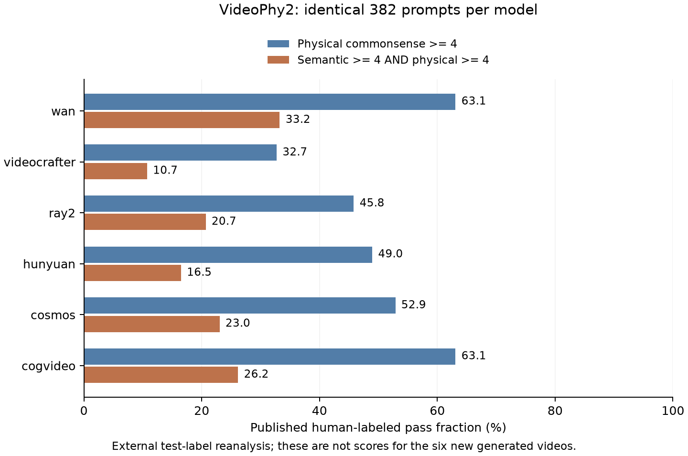
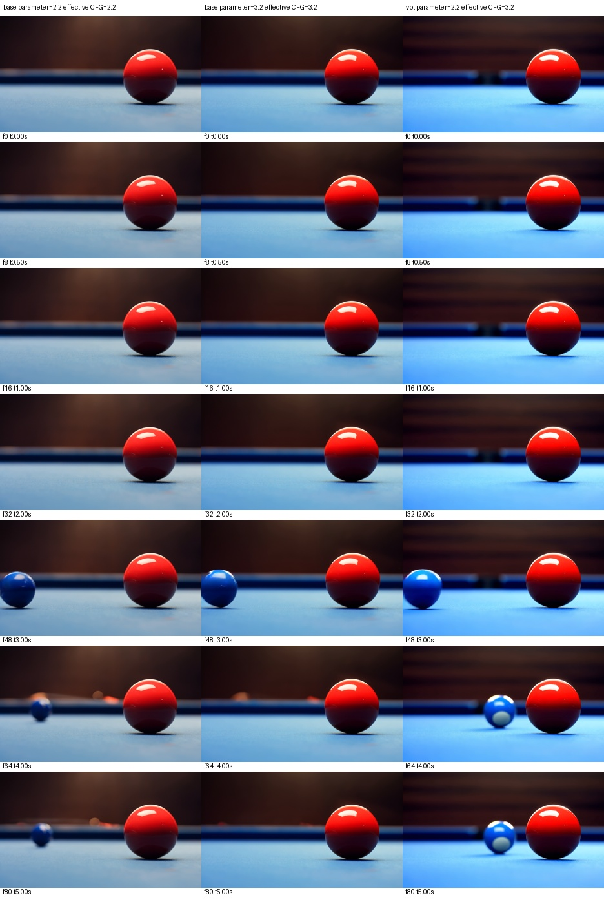

# 物理一致性论文调查与方法试用

日期：2026-11-14。研究问题有两个：相关论文如何定义和测量物理一致性；发布的VPT方法能否在现有硬件上实际运行，并留下有公平对照、可审查的输出。
已完成公开数据复算及6段正式生成，输出均通过`generation_audit.json`所列工程验收。
结果支持发布权重可运行，并揭示具体待测量现象；尚不支持物理一致性提升结论。

## 文献调查的结论

已读8篇直接相关论文的方法与实验设置，版本、章节、官方代码及适用限制见
[方法对照表](LITERATURE_REVIEW.zh.md)。
值得采用的设计包括：VideoPhy2把语义符合度SA与不看生成提示的物理常识PC分开；
PhyGenEval关注关键现象及事件次序；Physics-IQ Verified控制提示歧义、背景伪激活和分母；
Principia用同场景双物体关系减轻绝对尺度标定问题。
这些工作测量目标不同，不能混成一个分数。

本次直接尝试[VPT发布方法](https://arxiv.org/html/2607.04653v1)：它在Wan上联合学习视频、光流和角色图，
训练时使用独立噪声时间和辅助损失退火。本试验只运行发布检查点，不复现训练及早期检查点自引导。
本次优先解决方法接入与对照设置，并不预设物理提升结论。

## 试验一：复算VideoPhy2公开人工标签

数据来源：[作者公开测试表固定版本](https://huggingface.co/datasets/videophysics/videophy2_test/tree/90b81ffa54f565d9e40e83b7a2c247ba1dccfa2b)，
revision、大小及SHA256见`dataset_manifest.json`。数据只读，派生结果写入本研究目录。
公开文件有3,397段、600个不同提示、197种动作，其中hard子集1,015段。
该发布文件的提示数与所读v1正文所述590条测试提示有差异，因此这是固定公开版本的复算，
不声称完整重现论文全部数据。

按[VideoPhy2协议](https://arxiv.org/html/2503.06800v1#S3)计算`SA≥4且PC≥4`，
全部3,397行与文件原有joint字段一致。无重复video_url；SA/PC均在1–5范围。
不同模型覆盖不同提示，下表为各自公开数据上的描述统计，不是平衡对照排行榜。

| 公开表模型名 | 视频数 | SA≥4 | PC≥4 | 联合通过 | hard视频数 | hard联合通过 |
|---|---:|---:|---:|---:|---:|---:|
| cogvideo | 589 | 35.31% | 64.01% | 24.96% | 177 | 0.00% |
| cosmos | 585 | 40.51% | 53.68% | 24.10% | 175 | 10.86% |
| hunyuan | 587 | 31.69% | 49.40% | 17.21% | 178 | 6.18% |
| ray2 | 394 | 36.29% | 45.43% | 20.30% | 120 | 8.33% |
| sora | 60 | 36.67% | 60.00% | 23.33% | 19 | 5.26% |
| videocrafter | 591 | 16.75% | 35.19% | 10.49% | 168 | 2.98% |
| wan | 591 | 46.36% | 64.47% | 32.66% | 178 | 21.91% |

完整整数分子/分母及精确百分比见`videophy2_human_recomputed.csv`。
hard动作由作者基于CogVideoX-5B失败情况筛选，不是对每个模型都无偏的难度抽样；
尤其不能把该模型在hard上的低分当成独立挑选的泛化证据。
为减少覆盖差异，另取除小样本sora外6模型共同的382个提示，每模型各382段，结果见
`videophy2_human_common_prompts.csv`。该配对表中Wan的PC为63.09%，联合通过33.25%；
CogVideo的PC同为63.09%，联合通过26.18%。这说明单独PC不等于按要求完成任务的成功率，
不说明两者的裁判假阳性率，也不是本次新生成视频的分数。
交集分析只解决提示不一致，不能排除原始缺失机制、生成设置等差异。

图展示公开表有限样本的描述性比例，不给总体置信区间或显著性检验。
同提示跨模型配对，多个提示属于同动作，不能把所有行或规则当独立重复；
此处没有进行总体外推或新方法优越性检验。

候选规则字段共9,596条可解析规则提及，其中557条为无法确定，占5.80%；
另有1,862条人工补充违反规则，出现在1,821段视频。
无法确定字段的3个`[nan]`占位符单独登记为缺失，零基行号1202、2805、3332；未补造文本或通过标签。
这些规则数不是独立实验样本或裁判错误数。公开表没有逐标注员投票，无法重算标注员间一致性。

## 试验二：VPT发布权重配对生成

运行前协议见[TRIAL_PROTOCOL.md](TRIAL_PROTOCOL.md)，代码为`run_vpt.py`。
研究单位为2个提示，每提示固定seed42，三臂配对；每臂2段，不把81帧当81个独立样本。
全部使用480×832、81帧、16FPS、50步FlowMatch Euler、shift5；共享初始RGB噪声与负面提示。

| 臂 | 传入guidance参数 | 等效普通文本CFG | 用途 |
|---|---:|---:|---|
| 原始Wan | 2.2 | 2.2 | 引导强度诊断 |
| 原始Wan | 3.2 | 3.2 | 主要匹配对照 |
| 发布VPT | inner2.2、flow/seg均0 | 3.2 | 发布方法试用 |

VPT源码的引导公式为`joint + s*(joint-unconditional)`，因此参数2.2应与普通CFG3.2比较。
这是[官方固定代码](https://github.com/Tom-zgt/VPT/blob/3097bcd0267203a8192567d6eb2a9831b8015945/finetrainers/models/wan/custome.py)
核查所得，不是依据样本好坏调整。
新对照使用相同Euler配置，不与历史UniPC等设置下的旧视频直接比较。
两条提示在正式采样前固定，只写初态/触发动作，不规定反弹次数或碰撞后的运动结果。

实现使用未改动的官方推理AST定义，避免引入训练器依赖；构建原始Wan后扩展三流配置，
由官方加载器替换扩展投影和时间条件权重、加载LoRA。发布文件含11个完整张量及480个LoRA张量。
11个完整张量与加载后值逐项比较；基础Wan的8个权重文件重新校验通过。
源码Git blob、适配权重SHA256及基础模型revision分别保存在相应manifest中。

适配差异：独立入口、CPU卸载、共享CPU生成并量化到BF16的RGB噪声、CUDA BF16 autocast、系统ffmpeg输出。
保持官方三流前向和采样实现；VPT与普通Wan的内部数值路径仍有差别，比较的是发布方法整体。
保存无损压缩的uint8帧数组，浮点图像先常规量化到8位；MP4仅供播放，不能当作无损原始输出。
未进行训练、组件消融或跨检查点自引导，不构成完整论文复现。

正式运行完成6/6段，共486帧；逐段实际解码均为81帧、480×832、16FPS。
6个MP4哈希各异，视频/uint8帧数组哈希均已保存，共享RGB噪声哈希完全一致。
没有全黑或全白帧。相邻帧像素差仅作为内容诊断，未当成物理分数。
首次审计发现Diffusers的`_use_default_values`集合型元数据在两个进程中列表顺序不同；
将该字段排序后比较，其余调度数值逐项相同，完整审计通过。没有据此改动生成结果。

| 运行项 | 数量 | 每段耗时（含编码前后处理，不含首次模型加载） |
|---|---:|---:|
| 原始Wan，两个CFG臂 | 4段 | 192.20–193.85秒 |
| 发布VPT，inner2.2 | 2段 | 364.38–364.75秒 |

两GPU并行执行各臂；上述耗时是该机器的两例/四例运行观测，非总体性能估计。
发布VPT内部计算4个引导分支，不能把该耗时差单独归因于适配器参数。

查看了六张全部81帧的接触表，以及两个三臂对照表。以下是作者知道模型身份时的探索性观察，
不是盲评、人工独立标签、逐视频物理判决或成功率：

| 场景 | 原始Wan CFG2.2 | 原始Wan CFG3.2（匹配对照） | 发布VPT |
|---|---|---|---|
| 球释放 | 球全程在画面中，高度缓慢变化；没有从该检查直接量化自由落体或反弹 | 同样主要表现为缓慢高度变化 | f0–1未见球，随后从画面上沿进入；下落后长段高度变化较小 |
| 双球碰撞 | 蓝球后半段进入，大小、位置与背景中出现的额外形状均有变化 | f48可见蓝球，随后缩小，f64及f80未再见该蓝球 | f48蓝球进入，f53–59附近可见拉长/重影，f64及f80仍保留蓝球 |

这一配对样例提供了“物体持续存在”和“接触阶段形变”两类后续测量线索。
它不证明VPT满足动量守恒，也不能据2个提示、1个种子给出改进胜率。
完整原生帧接触表在`inspection/*_all81.jpg`；播放视频及8位帧数组在`generation/`。
稀疏对照图仅作导航，定性记录同时参考了全部原生帧接触表。

实际环境：Python3.12.3；Torch2.9.0+cu128、Transformers4.57.6、Diffusers0.36.0、
PEFT0.18.0、HF Hub0.36.0、Tokenizers0.22.2、Accelerate1.13.0、NumPy2.5.3、OpenCV4.13.0.92。
初次低分辨率软件检查曾因缺CUDA autocast和imageio ffmpeg插件失败；修正入口后完成3组冒烟检查，
正式生成6段全部成功。冒烟输出不计入6段和486帧。

旧研究保留校验也通过：Part B的771项校验、收尾269项和状态试点18项校验均未变，
详见`prior_studies_preserved.json`。未修改旧README快照及其交付清单。

## 结论边界与下一步选择

本次公开人工表复算不是新增人工标注，也不是VideoPhy2自动评估器校准。
自动评估器需要约14.3GB权重，下载较慢已取消；没有执行自动裁判，也没有新物理排行榜。
旧Part B校准失败仍然成立，假阳性控制、可靠小目标测量及本项目独立人工标签仍未解决。

建议后续聚焦“有受控初态的关系物理测量”，先从重力或摆动的一种关系做小型I2V试验，
用确定标签正反例验证事件测量和弃权，再接入生成器及人工校准。
这比继续从自由T2V单球像素轨迹拟合SI参数更符合当前证据；本次还没有验证该下一方向有效。
VPT样例可作生成方法候选，待有效评价门通过后再决定是否扩样或训练。

复算、生成和审计命令见[HANDOFF.md](HANDOFF.md)。依赖、固定输入、失败与适配差异均有记录。
训练权重和原下载文件在外部缓存；共享交付目录由`handoff_receipt.json`记录。
本轮材料保存在本地，未公开发布新的论文或新模型排行榜。
