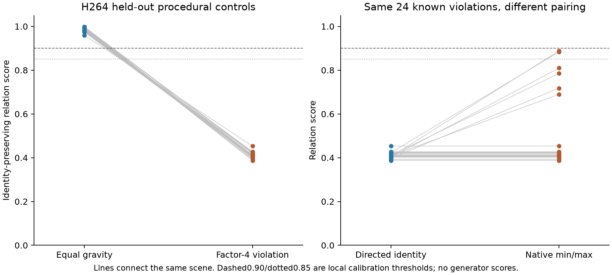

# Principia重力关系：测量与盲裁判校准

日期：2026-11-14。按用户要求，先验证受控双物体关系的测量和裁判，扩生成须等验证门。
**本轮两个限定范围的校准门均通过。** 已保存336个编码视频、逐段测量及12次首次独立视觉裁判。
这些结果支持进入有界I2V小试，不支持一般物理准确率或生成模型排名。

## 采用了论文的哪一部分

[Principia，arXiv2609.04200v1](https://arxiv.org/html/2609.04200v1)通过同场景双物体关系避免绝对尺度标定。
本轮只采用初始自由落体关系：同一重力下，高度比等于飞行时间比的平方。
保留左右物体身份，计算
`q=(hL/hR)/(TL/TR)^2`，并以`1-|hL/hR-(TL/TR)^2|/(hL/hR+(TL/TR)^2)`评分。
不输出SI重力参数。不同步释放、遮挡、相机移动或未观测到接触均不能直接判成物理错误。

适配边界：本轮是程序化控制视频和颜色连通域测量，不是完整Principia实拍首帧、SAM3或8现象基准。
已核查的项目缓存只有Wan和CogVideoX的T2V权重；未把自由T2V冒充原生I2V。
本轮没有增加生成器视频，也没有新增人工标注。

## 数据与预先固定的设计

[运行前协议](PROTOCOL.md)及[复核修正记录](REVIEW_RESOLUTION.md)保留全过程。
4开发场景、24未用于开发的留出场景，每场景6种配对条件：同重力、右球重力乘4、
延迟释放、落地前遮挡、相机移动、落地前截断。每段分别编码FFV1与H264 CRF23。
共28×6×2=336视频；两编码是技术重复，6条件是同场景配对，不能当336个独立场景。
完整片96帧/30FPS/512×384，截断片12帧。解析渲染器记录私有真值，测量只读取视频和公开几何标注。

条件由解析运动方程构造，不是实拍或外部人工真值。设计者同时实现渲染和测量，
因此该验证只覆盖指定模拟分布下的工程正确性；独立会话的视觉判断也不能消除该域限制。
固定颜色、同平面尺度、初始静止、恒加速度、已知地面和半径都是适用条件。
释放时刻由轨迹拟合顶点推断，不能当成从任何未知视频都可观察的事实。

## 测量留出结果

开发v1在H264中把标记压缩后的面积变化误判成相机移动；FFV1通过、H264失败。
保留v1源码、全部输出和失败门。v2改为对四个标记各自质心等权平均，未放宽阈值；
开发通过后冻结源码，才渲染/评估24个留出场景。留出后没有再改测量器或阈值。

每编码分别得到下表；288个留出编码案例全部计入，没有剔除失败或弃权。

| 留出条件 | 预期 | FFV1 | H264 |
|---|---|---:|---:|
| 同重力 | PASS | 24/24 | 24/24 |
| 重力乘4 | FAIL | 24/24 | 24/24 |
| 不同步释放 | ABSTAIN | 24/24 | 24/24 |
| 遮挡 | ABSTAIN | 24/24 | 24/24 |
| 相机移动 | ABSTAIN | 24/24 | 24/24 |
| 截断 | ABSTAIN | 24/24 | 24/24 |

各单条件24/24的Clopper–Pearson双侧95%区间为[85.75%,100%]，仅条件于此模拟分布。
不合并配对条件/编码来缩小区间。阈值PASS≥0.90、FAIL≤0.85、中间弃权，是本轮校准规则，
不是Principia论文公布的二分类阈值。

所有真值适用的案例均进入数值误差分母：每编码48/48完成测量，缺失为0。

| 最大绝对误差 | FFV1 | H264 | 预定上限 |
|---|---:|---:|---:|
| 采样接触帧 | 1帧 | 1帧 | 1.5帧 |
| 拟合释放时刻 | 0.363帧 | 0.380帧 | 1帧 |
| 高度 | 0.494像素 | 0.546像素 | 2像素 |
| 修正飞行时长 | 0.985帧 | 0.969帧 | 1.5帧 |
| 关系分数 | 0.05275 | 0.05290 | 0.06 |

接触帧误差以解析连续接触时刻向上取整后的第一采样接触帧为参照；飞行时长另与连续时刻比较。
均为全量案例的最大误差，不是均值或置信区间。
逐场景数值见[CSV](heldout_per_scene_errors.csv)，分母和原因见[条件表](measurement_condition_counts.csv)。

左图连线连接同一场景的同重力/违反条件；右图比较同一违反样例的身份保留与原版min/max配对。
本24场景分布中原版配对分数也没有达到本轮0.90通过线；不得据下述解析反例声称它在本留出集漏检。

## 官方实现核对带来的发现

按[固定官方代码](https://github.com/PrincipiaBench/Principia/tree/893e003804f0994ea6467b5a756ab657b82d4df9)
原样执行相关函数，源码Git blob和SHA256见[交叉验证](official_crosscheck.json)。
其事件模块分别将高度、时间取min/max，会丢失物体对应关系。构造`h=(2,1), g=(4,1)`时，
原版无序比值分数约1，身份保留分数0.4。因此本轮以有身份对应的关系为主，原版作诊断。
这是特定实现的可复查解析反例，不是对论文全部结论或其数据结果的否定。

另外，原版接触检测要求球心严格大于地面阈值；直接用物理地面线会与球半径冲突。
原版时间以视频第0帧为起点；同重力轨迹统一增加30帧预释放静止后，测试分数从0.98657降至0.85067。
我们分别处理接触几何和释放原点，不把这些仪器误差算成模型违反物理。

## 首次盲裁判校准

事先固定留出集前2场景的全部6条件，共12匿名案例。每案例一个全新无历史上下文的会话，
固定角色实际运行gpt-6-astra/high；只给公开设置、固定规则和按序的全部原生帧接触表。
帧表含984个帧索引，42张PNG；所有帧均保留，但空间上缩到原图一半，并非连续视频输入。
原始12份首次判决不重试、不修改。实际模型只暴露别名，没有日期化提供商版本。

| 条件 | 首次裁判 | 正确数 |
|---|---|---:|
| 同重力 | PASS | 2/2 |
| 明显不同重力 | FAIL | 2/2 |
| 不同步、遮挡、相机移动、截断 | 各类ABSTAIN | 各2/2 |

明显违反无漏报；正例无FAIL，0/2；缺失/不适用情形均弃权。
每条件只有2个场景，2/2成功的Clopper–Pearson95%区间为[15.81%,100%]；
0/2假阳性的双侧95%上界仍约84.19%。这不是低误报率或一般裁判准确性的证明。
不把12个同场景变体当成12个独立场景计算狭窄总体区间。

[会话收据](judge_session_receipts.json)与原始会话核对：12个不同会话、50次工具调用、42张实际图像哈希匹配，
未发现读取指定范围外文件。上下文隔离及读取审计不是操作系统沙箱；未暴露的运行时行为不能据此认证。
新裁判门还验证唯一分配、2×6覆盖、首次判决/载荷/图像哈希及每格2/2。
初版门的哈希绑定及重复分配漏洞在独立复核后加固；初版和原始首次结果都保留。
[加固后的门](judge_gate_v2.json)仍通过，13个针对性回归检查通过。

## 本轮决定与下一阶段

两个程序化校准门均通过，允许进入**小规模受控I2V可行性试验**，不直接扩大到模型排行榜。
下一阶段固定2个初态×2个种子，先核验首帧几何、同平面、可观测释放与落地，以及图像域跟踪覆盖率；
不满足则弃权并保留分母。需要准备原生I2V权重和真实/更接近真实的受控输入，之后才能讨论扩样。
本轮没有运行这一阶段，不把当前T2V缓存或程序化通过率当成它已完成。
旧PartB的失败校准没有被这次不同现象、不同输入协议的通过结果追认。

复现入口见[HANDOFF.md](HANDOFF.md)。验证记录覆盖336媒体哈希、24个新图像测量重放、
全部判决和输入哈希；独立复核结果见[REVIEW_RESOLUTION.md](REVIEW_RESOLUTION.md)。

## 来源与辅助软件

- Thozhiyoor et al.,2026. [Principia: Relational Physics Tests for Video Models](https://arxiv.org/abs/2609.04200)，所读v1；上述固定官方代码。
- 实验设计审查使用scientific-critical-thinking技能，过程检查及独立会话使用本地代理工具。
  辅助程序知识的软件引用：Kassis,T., Agarwal,V., He,Y., Patel,D., & Brueckner,A.M.(2026).
  [Scientific Agent Skills: A Library of Procedural Knowledge for Research Agents](https://doi.org/10.48550/arXiv.2609.00065)，核对当前v2，非本研究物理方法来源。
