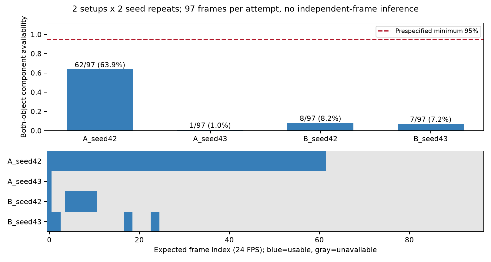
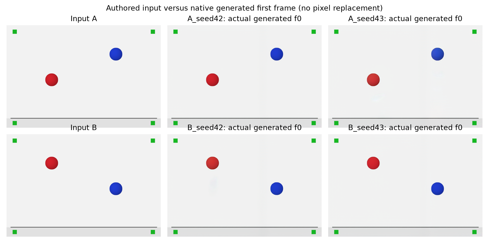
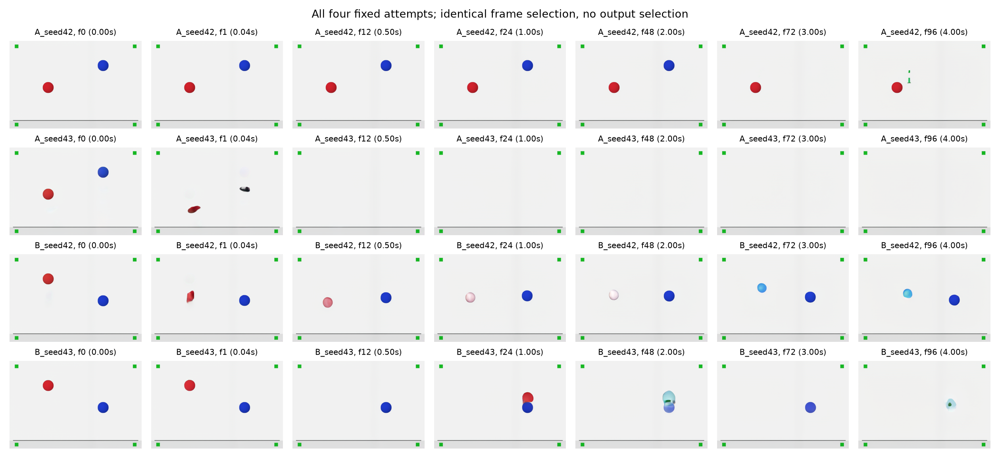

# 原生 I2V：2 初态 × 2 种子小试结果（2026-11-15）

本轮已完成四段真实的本地原生 I2V 生成、388 帧分析和预设扩样门检查。**初态保持 4/4 通过，跟踪覆盖率 0/4 通过，可用物理关系测量 0/4，因此停止扩样。** 这是一项有明确失败结果的可行性实验，不是物理正确率为零的实验。

## 问题、设计和论文依据

问题：在已经通过程序化控制校准的双物体测量器上，原生 I2V 是否能保留指定初态，并产生足够完整、可测的后续运动？

- 借鉴 [Principia，arXiv:2609.04200v1](https://arxiv.org/html/2609.04200v1) 的首帧条件和同场景双物体关系，保留左/右对象身份，比较高度比与平方飞行时间比。当前输入是自制程序化图像，未使用其真实首帧数据，不能称为复现完整 benchmark。此前已发现独立排序/归一化可能丢失对应关系，本轮不更改冻结的身份保持版本。
- 借鉴 [Physics-IQ Verified，arXiv:2606.18943v1](https://arxiv.org/html/2606.18943v1) 的装置、动作、相机提示与可评估性检查：提示同时释放和固定相机，不给加速度、到达顺序或目标得分；缺失对象、相机/装置失效单独报告。
- 使用 [LTX-Video 论文，arXiv:2501.00103](https://arxiv.org/abs/2501.00103) 对应模型系列的原生图像条件路径；具体实现是 [Diffusers 0.36.0 的 LTXImageToVideoPipeline](https://huggingface.co/docs/diffusers/v0.36.0/en/api/pipelines/ltx_video)。选型依据是现有显存与兼容性，不是观看生成物之后选择模型。

使用科学批判性检查区分观察、测量可用性与物理推断；相关方法性参考为 [Kassis 等，2026，arXiv:2609.00065](https://doi.org/10.48550/arXiv.2609.00065)，不将其列作本轮物理测量算法来源。

实验单位是四次生成，即两个初态各两个种子重复。A/B 交换左右球的高度；同种子跨初态使用相同未条件化噪声，实际哈希匹配。388 帧是重复测量，不是 388 个独立实验。没有显著性检验、置信区间或模型排名；两个人工构造初态不足以估计总体成功率。

## 冻结条件与运行方式

运行前协议是 [PROTOCOL.md](PROTOCOL.md)，生产前版本在 `source_snapshots/production_frozen/`，时间戳为 2026-11-15T04:20:47.866161+00:00。当前八个冻结源文件的 SHA256 全部仍一致。之后新增汇总、报告和交付代码，没有更改阈值、种子、模型或输入，也没有质量重试或选择性删样。

输入图像为 768×512；球半径 32px，左右 x=224/544，地面 y=464。A 左/右落高为 160/288px，B 为 288/160px；红/蓝用于身份识别。四个绿色标记提供装置检查。`inputs/` 保留精确图像、几何和掩膜；这不是自然摄影域验证。

模型为 `Lightricks/LTX-Video-0.9.5`，固定 revision `e58e28c39631af4d1468ee57a853764e11c1d37e`。Transformer、VAE、原发布的完整 T5 文本编码器和 tokenizer 全部下载并核验，未替换为其他模型的文本编码器。权重通过公开 ModelScope 直连镜像传输，但每个权重按固定 HF LFS SHA256 核验，小配置/tokenizer 文件按固定 Git blob 核验；镜像的可变 master 名不作为版本依据。完整清单见 `native_assets_complete.json`。

固定 seed=42、43；每段 97 帧，24 FPS，50 步，CFG=3，BF16，decode_timestep=0，原始 FlowMatchEulerDiscreteScheduler，CPU offload 和 VAE tiling。完整 prompt、negative prompt、scheduler 配置在每个初态的 `generation/primary/*/executed_protocol.json`。native pipeline 源 SHA256 为 `3b09e577af5a802e8b089244ef688b21f5db5d75cecb02b61cbb15b359fde163`。

原生接口将输入图像编码进首个 latent 时间片；观察器记录条件张量和噪声哈希，不改变返回值。每次生产运行均记录 384 个条件 token，输出形状均为 97×512×768×3。没有把输入图像粘到输出首帧。保留原生浮点输出正常量化后的 uint8 数组（`*_frames.npz`）、实际首帧 PNG、观看用 MP4；未保存量化前浮点张量。主测量使用数组派生的 FFV1 无损视频，MP4 不作为主测量输入。

预先定义的主要门：首帧对象中心误差≤8px、等效半径比 0.75–1.25、mask IoU≥0.60；四标记初始位置误差≤3px，地面误差≤3px；两球完整且唯一、面积为输入的 0.75–1.25 倍，覆盖至少 93/97 帧，最长不可用段≤2 帧。物理测量还要求冻结旧测量器通过，以及逐标记全程漂移≤1.5px、地面全程可见、初始落体到达合理接触位置而非反弹后的停稳。任一关键门失败则不扩样。

## 实际结果

结果来源为 [pilot_gate.json](pilot_gate.json) 和 [逐段 CSV](summary/clip_metrics.csv)。四次均成功生成并实际解码为 97 帧、24 FPS；所有尝试都保留在分母中。

| 初态/种子 | 首帧对象/装置 | 双物体可用帧 | 覆盖率 | 最长不可用段 | 全程标记门 | 物理关系 |
|---|---|---:|---:|---:|---|---|
| A/42 | 均通过 | 62/97 | 63.9% | 35 帧 | 失败（17 帧标记不可用） | N/A |
| A/43 | 均通过 | 1/97 | 1.0% | 96 帧 | 通过 | N/A |
| B/42 | 均通过 | 8/97 | 8.2% | 86 帧 | 通过 | N/A |
| B/43 | 均通过 | 7/97 | 7.2% | 72 帧 | 失败（7 帧标记不可用） | N/A |

八个首帧对象的最大中心误差为 0.5273px，IoU 范围 0.9726–0.9928。地面线在四段全部帧可见、位置误差均为 0px。单图 VAE posterior-mode 重建也通过对象和装置检查，像素 MAE 为 A=0.9183、B=0.9299（0–255 标度）；这只能说明单图编码/解码诊断，不能代表时序非因果解码的首帧或后续运动。实际生成首帧已单独评估。

覆盖率是当前颜色/连通域仪器的**可用性**，不是标注验证过的跟踪准确率。所有帧合计 78/388 同时可用仅作描述，不能当作独立样本的物理通过率。对象变色也会导致该仪器失效，因此不能把每次不可用直接解释为对象消失。`summary/frame_component_diagnostics.csv` 是生成后新增的探索性失败分类，未参与预设门或重新评分。

已目视检查四张完整 97 帧接触表；属于研究者定性检查，没有新增人类盲标标签。A/42 两球长时间悬停，之后蓝球淡出并出现绿色伪影；A/43 开始后迅速变形并在短时间内不可见；B/42 左球变形、变色且未形成可用的双球落地事件；B/43 左球间歇消失、接近右球并改变外观。这些现象与低可测性相符，但这里不把定性观察升级为经校准的逐段物理裁决。

旧测量器在 A/42、B/43 返回 `fiducial_missing`，在 A/43、B/42 返回 `object_missing_or_ambiguous`，因此四次均无关系分数。A 与 B 可用关系数各 0/2。没有可聚合的物理 leaderboard，也没有把 N/A 当作 FAIL 或 PASS。此前程序化校准和旧 Part B 校准是不同实验，不能用本轮初态成功使旧 Part B 裁判变为有效。



图中虚线是预设 95% 最低覆盖率；还必须同时满足最长缺失段等其他条件。没有误差线，因为这里只展示四次实际尝试。





所有图均有同名 PDF/SVG 和可重建源码 `summarize.py`。完整 388 帧接触表在 `inspection/*_all97.jpg`，四个 MP4 和原始量化数组在 `generation/primary/{A,B}/`。

## 验证范围、失败与 warnings

1. 四个新几何/FPS 正反控制在生产前通过原冻结测量器；A/B 同重力分数均约 0.96785，反控制为 0.44211/0.40207。独立只读审查直接复现这四项控制，并确认原生条件路径，详见 `PREPRODUCTION_REVIEW.md`。这些是程序化控制，不是自然视频误报率估计。
2. 生产前七项针对性测试已运行并通过（7 passed, 6.02s），覆盖正例、97帧固定分母、长缺口、对称缩放、地面移动、低于地面的平台、反弹后停稳。新增 wrapper 实现未另作独立审查；审查报告只确认它提出的问题和旧控制。
3. `summary/artifact_verification.json` 记录独立产物检查：八个生产冻结源文件未变；实际首帧等于数组第 0 帧；输入哈希/运行源码一致；388 个无损视频帧逐像素等于存储数组。原始视频生成没有重跑。
4. 公开权重经代理下载过慢的初次尝试已停止，改用经过内容哈希核验的直连镜像；原日志和源码版本保留。首个单图 VAE 诊断发生 `TypeError: ...decode() got an unexpected keyword argument 'timestep'`，生产前改为正确的位置参数后诊断完成；失败日志 `vae_diagnostic.log`、成功日志 `vae_diagnostic_v2.log` 和修改前后源快照都保留。这不是失败的生产视频重抽样。
5. 模型加载记录了 `torch_dtype is deprecated! Use dtype instead!` 警告；该版本下成功执行，无忽略异常、无修改冻结代码来消除警告。LSP basedpyright 未安装，用户此前已拒绝安装，本轮没有安装；依靠实际 Python 执行与针对性测试。

## 软件与复核入口

推理解释器 `/data/AI_Research/shared/physics_methods_20261114/env_vpt/bin/python`，Python 3.12.3，Torch 2.9.0+cu128 / CUDA 12.8、diffusers 0.36.0、transformers 4.57.6、accelerate 1.13.0、peft 0.18.0、huggingface-hub 0.36.0、tokenizers 0.22.2、safetensors 0.8.0；两个 RTX 5090，驱动 595.99.02。A/B 分别使用 GPU0/1。没有调用付费推理服务。

分析解释器 `/home/room115/pytorch_env/bin/python`，Python 3.12.3，numpy 2.5.3、scipy 1.18.1、Pillow 12.3.0、opencv-python 4.13.0.92、matplotlib 3.11.2。该环境中的其他推理包版本不同，**生成必须使用前述隔离推理解释器**，不可混用。精确的推理环境版本另存交付包 `INFERENCE_ENVIRONMENT.json`；分析版本在 artifact_verification 中。

实际执行顺序：固定版本取权重 → prepare_inputs → 四控制 → 原生小分辨率 smoke → VAE 诊断/API修正 → wrapper 测试和源码冻结 → A/B 各两个固定种子 → evaluate → summarize。以下为核心入口（项目根目录）；生成文件已存在，脚本拒绝覆盖。再次实验须使用独立研究副本/新输出名，不要直接覆盖本次材料。

```bash
/data/AI_Research/shared/physics_methods_20261114/env_vpt/bin/python research/principia_i2v_20261115/run_i2v.py --model /data/AI_Research/shared/principia_i2v_20261115/ltx_095 --gpu 0 --initial A --mode production
/data/AI_Research/shared/physics_methods_20261114/env_vpt/bin/python research/principia_i2v_20261115/run_i2v.py --model /data/AI_Research/shared/principia_i2v_20261115/ltx_095 --gpu 1 --initial B --mode production
/home/room115/pytorch_env/bin/python research/principia_i2v_20261115/evaluate.py --generation research/principia_i2v_20261115/generation/primary --output research/principia_i2v_20261115/pilot_gate.json
/home/room115/pytorch_env/bin/python research/principia_i2v_20261115/summarize.py
```

只读复核可使用 JSON/CSV、接触表和交付哈希，无需再次生成视频。`legacy_preservation.json` 记录旧 Part B/closeout/stage0 快照校验；本轮不会改变旧成果的有效性判断。

## 决策与下一阶段

扩样门 `expand_generation=false`。当前得到的可用成果是：原生条件路径和首帧几何保持已实际证明；现有模型、程序化初态和颜色仪器组合的时序可测性未通过。这不能单独归因于模型物理能力、合成域偏移或跟踪器，当前设计无法拆分三者贡献。

下一阶段应先建立与 Principia 更接近的真实/写实初态和运动测量验证，而不是追加本配置种子：用已知轨迹的外观/光照变化控制比较颜色仪器与通用分割/跟踪，加入少量独立人工中心/身份标签验证覆盖率与定位误差；分别设定身份、运动事件、相机和关系测量门。新输入或模型的试验需要新协议、独立样本和相同四段规模的预检；本轮四段不能转作未来未见验证集。这里仅提出下一阶段，没有启动额外生成。

原 proposal 的校准 Part B 裁判、低假阳性控制、可靠最小目标测量及 human labels 仍未因此完成。本轮没有制造人工标签，也没有形成多模型 leaderboard。所有源码、原始量化帧、视频、派生指标、图表、失败及版本快照保存在本研究目录；本地完整交付位置和哈希见 `handoff_receipt.json`。大模型权重不复制进交付包，保留固定版本与逐文件哈希以供重取。
