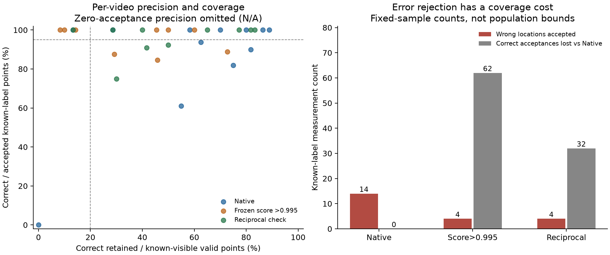

# 外部真实域测量与误接受验证（2026-11-17）

## 方向与问题

优先优化评测器的真实域对应/可见性测量；裁判校准次之；评价链路有效前不扩大生成。
本轮问题：已冻结的CoTracker3及DAVIS置信门能否在新的人工标签上同时保持精度、覆盖，
加入原始参考帧往返核验能否挡住错误而保留有用测量？模型权重不训练、门槛不按成绩搜索。

## 设计与数据

原作者EgoPoints人工标注，12段、10参与者组、
119条查询、5021帧。
每个原EPIC视频只取一个片段；参与者内仍相关。来源前缀1,207,959,552字节，
原包59,478,937,600字节，不宣称取得完整数据集。
选择按运行前记录的PROTOCOL/V2/V3：原包至多前3GiB中的归档顺序前12个完整、64–1200帧、
不同原视频片段。数据可用性修订全部早于新推理/成绩，未按结果换片段。
归档顺序不是均匀随机抽样；这是外部小试，不是完整EgoPoints榜单或生成片域的验证。

作者只在少量帧人工标注。只有vis_valids有效的帧进入可见性计分；初始查询帧排除。
坐标正确采用已知可见且有有效坐标、归一化至256×256后L2<4像素。
未标注的默认0不当作遮挡；已知负例的错误接受保留在精度分母；推理失败保留计划分母。
原始RGB帧全部进入原生跟踪，512×288输入；查询外的真值不进入网络。
三种方法均允许知道请求测量的时间戳；往返核验只在这些时间戳调用，故不声称密集身份可测。

三臂为原生可见声明、旧DAVIS固定v*c>0.995门、以及原生声明加反向对应<4归一化像素的往返门。
反向只输入候选帧与原参考帧，从自身候选位置追回，另外要求反向原生可见和图内坐标。
网络版本/查询支持网格/迭代固定；未来真值另存于truth.npz并只由计分器读取。

## 实际结果

首次执行仅7/12成功，失败均为CUDA OOM。新执行仅在每次完整视频查询前
释放未使用的CUDA缓存，没有改权重/参数/精度/帧/阈值；12/12成功。
全部7个原成功片段的所有数组逐值（含NaN位置）完全一致：
`True`。首次输出和包含失败的计分另存analysis_first_attempt；
下表是预先记录资源修正后的统一12段执行，不是按人工准确率挑选版本。

|方法|正确/接受|接受精度（描述性95%区间）|正确点保留率（描述性95%区间）|遮挡/OOV误接受|重现恢复|严格恢复|经验门|
|---|---:|---|---|---:|---:|---:|---|
|Native|124/138|89.86% [79.84%, 97.92%]|60.19% [41.38%, 75.36%]|0/21|12/16|12/16|False|
|Frozen score >0.995|62/66|93.94% [87.50%, 100.00%]|30.10% [14.55%, 43.32%]|0/21|1/16|1/16|False|
|Reciprocal check|92/96|95.83% [90.20%, 100.00%]|44.66% [26.44%, 60.38%]|0/21|4/16|4/16|True|

- Frozen score >0.995相对原生：少接受错误10个，同时丢失原本正确测量62个。坐标没有更新，不能称定位/身份恢复改善。
- Reciprocal check相对原生：少接受错误10个，同时丢失原本正确测量32个。坐标没有更新，不能称定位/身份恢复改善。

原生各点坐标的可见位置正确数为141/206，
这是不依赖接受门的定位诊断；三个门使用相同坐标。重现事件仅指人工标注的OOV→随后可见
转换，不估计未标注中间帧的精确遮挡时长；严格恢复还要求先前OOV没有错误可见声明。
逐视频和宏均值、分母有效视频数、OOV/图内遮挡的误接受分解均保存在analysis JSON中。

## 结论与下一步优先级

往返门通过本轮预设的经验点估计门，但不能称通用可靠测量器。它的精度区间仍为[90.20%, 100.00%]，
只有7/12个计划视频的经验精度≥95%，
其中2段完全没有接受点。
16个标注重现事件只来自3个参与者组；原生12次正确恢复中有
8次被往返门挡掉，其中
3次反向可见性拒绝、
7次往返距离超阈（原因可重叠）。

**下一阶段第一优先级是重现后的正确定位与重识别候选，而非继续提高置信门。**
当前65/206个可见位置本身就不准，
另有17个正确位置被原生可见性拒绝。
应以发布的参考帧对应/重定位方法（例如PointSt3R方向）为下一组基线，用新的参与者/视频
以及更充分的人工重现负例验证。本轮样本此后只能作开发/回归，不能在其上调门再称新验证。
往返门保留为候选验证分支，暂不升级为自产I2V的生产测量器。

第二优先级仍是物理裁判校准：先验证同一观察输入中真实可辨的正/反/不可判例，
再冻结重跑；第三维方法和生成扩样继续等待二维身份与物理标签证据。

## 不确定性、验证和局限

置信区间对参与者整组bootstrap10000次，seed20261117；方法差值使用同一组抽样。
它只是此固定样本的描述性区间，不含训练不确定性、标注误差或跨生成域保证；空分母记N/A，
有效抽样次数逐项保存。没有把查询/帧当独立视频，也没有计算独立点帧显著性P值。
本样本只有21个已知不可见点时、其中20个OOV和1个遮挡，三方法均0次误接受。
这不是总体零假阳性保证；其机械全零bootstrap区间[0,0]退化，不作为安全上界，详见STATISTICAL_NOTE.md。
重现区间仅在有分母的9682/10000次抽样上计算，也不能把16事件当独立重复。
经验门定义为池化精度≥95%、正确保留≥20%、至少一半计划视频有≥5个正确接受点时，
即使经验门通过也不构成未知域的可靠性保证。

软件检查：`123 passed in 8.37s`，compile退出0。
反例包括未知帧、推理失败、不可核实接受、坐标缩放、以及“往返一致但身份错误”的假阳性。
不同家族本地GLM/Qwen实际审查及逐条裁定见REVIEW_RULINGS.md；其中无证据指控没有驱动修改，
不将模型意见包装成独立全面通过。LSP未安装，未宣称静态检查通过。

当前标签只支持点对应及可见性终点，不能直接证明物体质心、g/T或物理VLM裁判可靠。
这里的误接受是点定位/可见性错误，不是“误判物理违反”的假阳性率，不能替代裁判校准。
本轮没有训练生成模型，没有新增生成片、调到通过或修复旧Part B的失败门。
自身生成视频的人类物理标签仍缺。下一步应针对本轮暴露的坐标错误或拒绝损失选方法，
并使用新的验证集合；不能继续把此样本当未见验证反复优化。

## 文献借鉴、复现与声明

- [EgoPoints，Darkhalil等，WACV2025](https://arxiv.org/abs/2412.04592)：借鉴人工可见性/OOV分离、稀疏标注与重现终点；未复刻作者完整排名。
- [PointSt3R，Guerrier等](https://arxiv.org/abs/2510.26443)：参考跨帧对应思路；本轮没有运行它的MASt3R模型或训练。
- [BootsTAP](https://arxiv.org/abs/2402.00847)：参考查询一致性的研究动机；本轮不是该方法的自监督训练复现。
- 实验设计工作流参考Kassis、Agarwal、He、Patel、Brueckner，2026，
  [Scientific Agent Skills](https://doi.org/10.48550/arXiv.2609.00065)，v2元数据已核实，未视为方法有效性证据。

实际软件版本见tests_receipt.json；权重和作者源码继承已有assets.json固定哈希。
完整协议、样本、源图哈希、原始标签/预测、首次失败均保留；仅本地交接，原视频权利仍归原来源。
首轮入口为prepare.py→run_models.py两分片；资源修正执行为run_models_memory.py两分片，
主结果计分使用analyze.py的--predictions predictions_memory，再由report.py渲染。准备/推理默认不覆盖，
重跑请复制到新目录并调整清单。交接包实际执行复制源码的缓存计分重放；不宣称干净机器网络安装。

AI披露：GPT辅助实现/分析/写作，GLM与Qwen作独立上下文审查；真值来自作者人工标签，
没有把AI意见写作人工标注。没有公开上传、付费API或Google/gingersea操作。

## 逐视频结果

|视频|方法|精度|保留率|错误可见声明/负例|错误位置|运行|
|---|---|---:|---:|---:|---:|---|
|P28_06_start_19143_end_19361|Native|100.00%|80.00%|0/2|0|ok|
|P28_06_start_19143_end_19361|Frozen score >0.995|100.00%|60.00%|0/2|0|ok|
|P28_06_start_19143_end_19361|Reciprocal check|100.00%|65.00%|0/2|0|ok|
|P02_121_start_4612_end_4867|Native|61.11%|55.00%|0/0|7|ok|
|P02_121_start_4612_end_4867|Frozen score >0.995|100.00%|10.00%|0/0|0|ok|
|P02_121_start_4612_end_4867|Reciprocal check|75.00%|30.00%|0/0|2|ok|
|P28_109_start_4111_end_4435|Native|100.00%|86.36%|0/0|0|ok|
|P28_109_start_4111_end_4435|Frozen score >0.995|100.00%|45.45%|0/0|0|ok|
|P28_109_start_4111_end_4435|Reciprocal check|100.00%|77.27%|0/0|0|ok|
|P01_103_start_3324_end_3632|Native|100.00%|70.00%|0/6|0|ok|
|P01_103_start_3324_end_3632|Frozen score >0.995|N/A|0.00%|0/6|0|ok|
|P01_103_start_3324_end_3632|Reciprocal check|100.00%|40.00%|0/6|0|ok|
|P24_09_start_313_end_514|Native|100.00%|13.33%|0/1|0|ok|
|P24_09_start_313_end_514|Frozen score >0.995|N/A|0.00%|0/1|0|ok|
|P24_09_start_313_end_514|Reciprocal check|100.00%|13.33%|0/1|0|ok|
|P02_107_start_1554_end_2636|Native|100.00%|28.57%|0/0|0|ok|
|P02_107_start_1554_end_2636|Frozen score >0.995|100.00%|14.29%|0/0|0|ok|
|P02_107_start_1554_end_2636|Reciprocal check|100.00%|28.57%|0/0|0|ok|
|P04_04_start_28868_end_29108|Native|81.82%|75.00%|0/2|4|ok|
|P04_04_start_28868_end_29108|Frozen score >0.995|84.62%|45.83%|0/2|2|ok|
|P04_04_start_28868_end_29108|Reciprocal check|92.31%|50.00%|0/2|1|ok|
|P11_104_start_5481_end_5915|Native|100.00%|88.89%|0/0|0|ok|
|P11_104_start_5481_end_5915|Frozen score >0.995|100.00%|50.00%|0/0|0|ok|
|P11_104_start_5481_end_5915|Reciprocal check|100.00%|83.33%|0/0|0|ok|
|P07_101_start_21871_end_22843|Native|100.00%|58.33%|0/10|0|ok|
|P07_101_start_21871_end_22843|Frozen score >0.995|100.00%|8.33%|0/10|0|ok|
|P07_101_start_21871_end_22843|Reciprocal check|N/A|0.00%|0/10|0|ok|
|P12_101_start_100042_end_100182|Native|90.00%|81.82%|0/0|1|ok|
|P12_101_start_100042_end_100182|Frozen score >0.995|88.89%|72.73%|0/0|1|ok|
|P12_101_start_100042_end_100182|Reciprocal check|100.00%|81.82%|0/0|0|ok|
|P06_09_start_47767_end_48123|Native|93.75%|62.50%|0/0|1|ok|
|P06_09_start_47767_end_48123|Frozen score >0.995|87.50%|29.17%|0/0|1|ok|
|P06_09_start_47767_end_48123|Reciprocal check|90.91%|41.67%|0/0|1|ok|
|P08_21_start_381_end_860|Native|0.00%|0.00%|0/0|1|ok|
|P08_21_start_381_end_860|Frozen score >0.995|N/A|0.00%|0/0|0|ok|
|P08_21_start_381_end_860|Reciprocal check|N/A|0.00%|0/0|0|ok|
