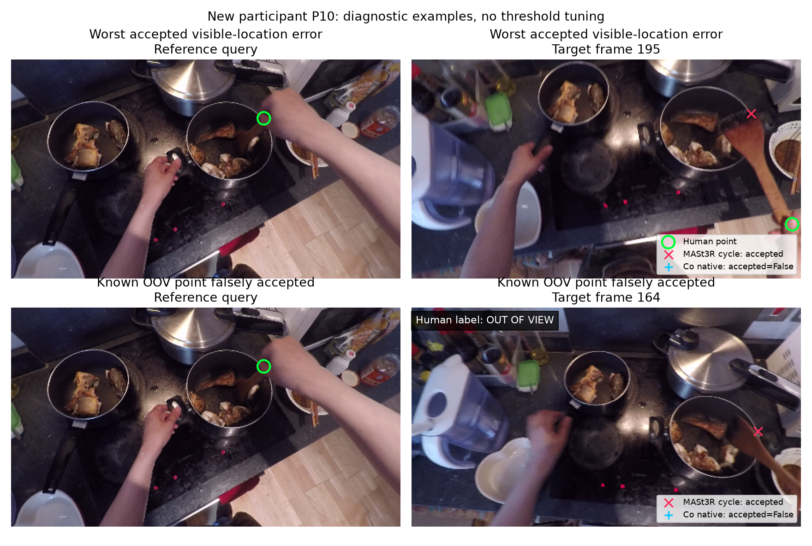

# 新参与者结果的分布和错例

主报告：[REPORT.zh.md](report_v2/REPORT.zh.md)。这是冻结比较后的描述性诊断，没有改阈值或重新选样。

新验证的12次标注出画→重现中，10次来自P30，P10和P35各1次，不能把它们当作12个独立重复。
按3位参与者聚类重采样，恢复率95%描述区间为0%–100%。所有12个已知缺席标签都是出画，
没有遮挡负例，因此没有验证遮挡准确率，更没有测量物理违规的假阳性率。

| 片段参与者 | 原生接受精度 | MASt3R往返接受精度 | 原生坐标正确 | MASt3R坐标正确 |
|---|---:|---:|---:|---:|
| P10 | 10/15 | 6/22 | 11/21 | 6/21 |
| P30 | 5/5 | 6/10 | 8/12 | 6/12 |
| P35 | 9/9 | 9/9 | 9/9 | 9/9 |

P35两方法均定位正确，不能从汇总结果推断每段都失败。P10的MASt3R往返门接受了全部22个
已标注候选，其中15个可见点位置错误、1个点实际已出画；自洽门在该段完全没有过滤候选。
下图按固定规则展示最大可见点错误，以及全部出画误接受（本轮恰好1个）。出画点没有可用
目标坐标，图中只显示人工缺席标签，绝不把原始占位零坐标画成真值。

这能证实：同一对特征图的往返一致不足以保证对应身份或可见性。图像中的相似外观/动态目标
可能是失配原因，但本轮未用消融实验验证具体训练机制；不能把该假设写成因果结论。
动态微调PointSt3R及其可见性头没有取得权重，这个静态基线结果不能替代对原方法的评估。

当前决策是保留CoTracker3对照，不采用静态MASt3R替换方案。下一轮先比较显式可见性与
持续身份的动态方法，并继续单独核算新增正确坐标、丢失坐标和错误接受；三维链路还要
核实移动相机的位姿及估计深度，不能借用静止相机假设或人工未来坐标。
