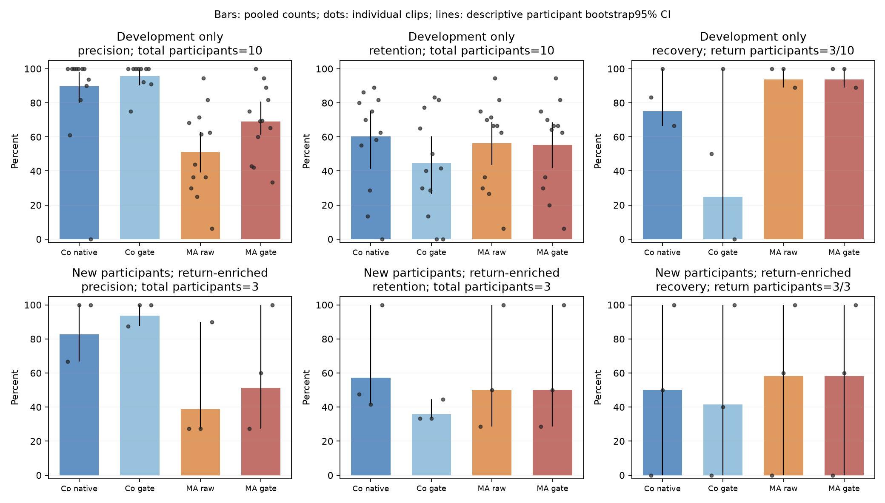
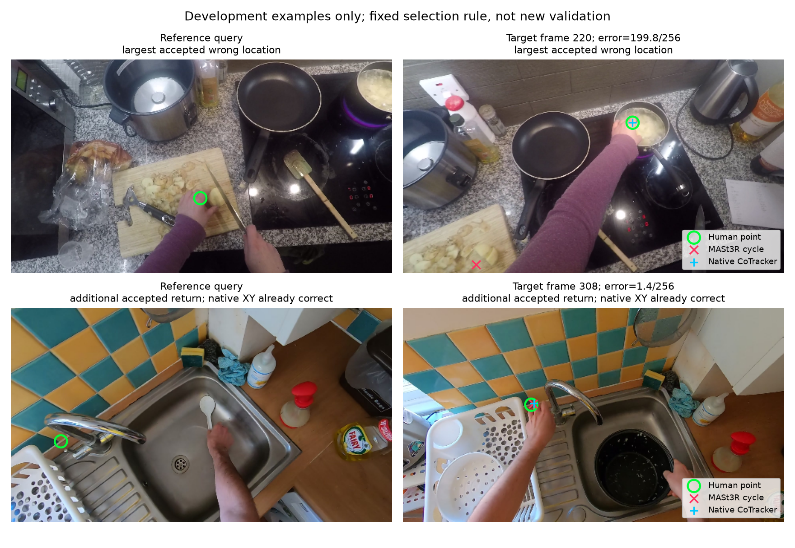

# 参考帧全局重定位实验收尾

生成时间：2026-11-18T01:00:57.973142+08:00。研究目录保留开始日期20261117；本报告使用实际完成时间。

本轮完成公开 MASt3R 静态基线的真实推理及四方法比较。PointSt3R 官方分享链接已过期，
没有运行其动态微调或可见性权重。旧样本只用于开发检查，新验证与旧10位参与者隔离。
“往返可匹配”不等于人工身份正确；本轮不会据此升级物理测量器或公布生成模型排名。

**主要结论：新参与者验证中，原生坐标正确 28/42，MASt3R 为 21/42；真正新增正确位置 0 个，丢失原生正确位置 7 个。接受精度从 82.76% 降至 51.22%。据此保留原生 CoTracker3 对照，不将静态 MASt3R 全局匹配升级为替代测量器。**

## 设计、材料和单位

固定协议见 [PROTOCOL.md](../PROTOCOL.md)，方法适配与边界见
[METHOD_NOTES.zh.md](../METHOD_NOTES.zh.md)。同一公开 EgoPoints 作者归档，复用已校验旧区段，
最多取得首3GiB逻辑前缀；排除旧10位参与者，按归档顺序选每位新参与者首个完整、64–1200帧、
有人工标注出画→可见重现的片段，上限6位。此为重现富集样本，不是随机代表性测试。
没有新增人工标签，也没有把AI意见当作真值。参与者是聚类单位，点/帧不是独立重复。

实际前缀 3,221,225,472 字节，完整扫描 32 段，
选入 3 段 / 3 位新参与者，
共 1051 帧、27 个初始查询。
边界未完成片段 P10_04_start_76984_end_77369 不纳入。
原图缩放为512×288；归一化误差为 sqrt((dx×256/W)²+(dy×256/H)²)，严格小于4算定位正确。
仅在人工 vis_valids 已知的未来时刻评分，初始查询时刻及未知帧不进入分母。
所有计划内推理失败保留分母，不能通过删去失败视频提高结果。

## 新参与者验证

| 方法 | 接受精度 | 正确保留率 | 全可见点坐标准确率 | 接受的重现恢复 | 假可见 |
|---|---:|---:|---:|---:|---:|
| CoTracker3 native | 24/29（82.76%） | 24/42（57.14%） | 28/42（66.67%） | 6/12（50.00%） | 0/12（0.00%） |
| CoTracker3 reverse gate | 15/16（93.75%） | 15/42（35.71%） | 28/42（66.67%） | 5/12（41.67%） | 0/12（0.00%） |
| MASt3R forced matching | 21/54（38.89%） | 21/42（50.00%） | 21/42（50.00%） | 7/12（58.33%） | 12/12（100.00%） |
| MASt3R reciprocal gate | 21/41（51.22%） | 21/42（50.00%） | 21/42（50.00%） | 7/12（58.33%） | 1/12（8.33%） |

标注重现事件 12 次，分布在 3 位参与者。原生坐标正确 8 次，MASt3R 坐标正确 7 次；新增正确重现坐标 0 次，丢失原有正确重现坐标 1 次。新增被接受的正确恢复 1 次，其中 1 次原生坐标已经正确。

全部 42 个已知可见且坐标有效的点时刻中，两方法都定位正确 21 个，仅原生正确 7 个，仅 MASt3R 正确 0 个，均不正确 14 个。这是按固定4/256阈值做的配对诊断，没有用新结果重选模型或阈值。

| 方法 | 接受精度95%描述区间 | 保留率95%描述区间 | 重现恢复95%描述区间 |
|---|---:|---:|---:|
| CoTracker3 native | [66.67%, 100.00%] | [41.67%, 100.00%] | [0.00%, 100.00%] |
| CoTracker3 reverse gate | [87.50%, 100.00%] | [33.33%, 44.44%] | [0.00%, 100.00%] |
| MASt3R forced matching | [27.27%, 90.00%] | [28.57%, 100.00%] | [0.00%, 100.00%] |
| MASt3R reciprocal gate | [27.27%, 100.00%] | [28.57%, 100.00%] | [0.00%, 100.00%] |

新样本既没有训练也没有调参。置信区间为参与者聚类重采样10000次，种子20261117，
只描述选中样本；不足两个参与者或退化分布不显示区间。尤其零假阳性重采样不能给出
总体假阳性风险上界。每段完整计数、失败状态见 `analysis_validation/`（若无样本则不产生该目录）。
条件选择、少量参与者、稀疏标签及未知预训练重叠均限制外推；没有进行显著性或因果推断。
本轮3段共1051帧、27个查询、54个已知未来点时刻：42个可见、12个出画。
没有已知遮挡负例；出画恢复结果不能充当遮挡判断准确率。MASt3R 往返门仍有19个错误位置和1个出画误接受。

## 旧开发样本：不充当新增验证

12段 / 10位参与者 / 119查询 / 5021帧。这里复用前轮冻结 CoTracker3 缓存，
对同样输入新跑 MASt3R；没有把复用结果计为新增生成视频或新人工重复。

| 方法 | 接受精度 | 正确保留率 | 全可见点坐标准确率 | 接受的重现恢复 | 假可见 |
|---|---:|---:|---:|---:|---:|
| CoTracker3 native | 124/138（89.86%） | 124/206（60.19%） | 141/206（68.45%） | 12/16（75.00%） | 0/21（0.00%） |
| CoTracker3 reverse gate | 92/96（95.83%） | 92/206（44.66%） | 141/206（68.45%） | 4/16（25.00%） | 0/21（0.00%） |
| MASt3R forced matching | 116/227（51.10%） | 116/206（56.31%） | 116/206（56.31%） | 15/16（93.75%） | 21/21（100.00%） |
| MASt3R reciprocal gate | 114/165（69.09%） | 114/206（55.34%） | 116/206（56.31%） | 15/16（93.75%） | 0/21（0.00%） |

标注重现事件 16 次，分布在 3 位参与者。原生坐标正确 15 次，MASt3R 坐标正确 15 次；新增正确重现坐标 0 次，丢失原有正确重现坐标 0 次。新增被接受的正确恢复 3 次，其中 3 次原生坐标已经正确。

全部 206 个已知可见且坐标有效的点时刻中，两方法都定位正确 106 个，仅原生正确 35 个，仅 MASt3R 正确 10 个，均不正确 55 个。这是按固定4/256阈值做的配对诊断，没有用新结果重选模型或阈值。

MASt3R 往返门通过的51个错误位置说明自洽不足以保证正确。原生完整跟踪在全部可见点的
定位正确数是141/206，MASt3R 为116/206；原生接受的重现恢复12/16与新方法15/16的差异，
不能直接称为新增坐标恢复。示例采用固定规则：最大被接受位置误差，以及首个新增接受的正确重现，
不是代表性抽样，也没有用示例选择新阈值。

## 实现、校验和失败

模型源码固定于 a03c21f9244f937e85e160971a255e2d529740bf；MASt3R PTH SHA256
`e28f91b488554653e2b46ddae9c78c1143e0bcb2e27d3e26cdb0b717f1568eb2`。
严格核对无缺失或意外权重键。原始PyTorch RoPE回退及上游 autocast 弃用警告保留在日志中，
没有修改发布源码或声称编译CUDA扩展。模型推理全部本地，外部推理API费用0；未计量电力和硬件成本。

六个匹配器反例测试覆盖亚像素、边界、并列最大值、非往返、零/非有限描述子和外观一致却可能缺席的点。
另有实际分析CLI测试，检验失败保留分母、未知标签、严格恢复与复制缓存重放。
真实24维描述子上，8个查询与作者原始采样及逐点余弦代码坐标完全一致，缓存和哈希见 `matching_audit/`。
扩大实现校验后，全部12段、23个图像对、227个请求查询均与作者逐点匹配一致，重复推理坐标也完全一致，见 `matching_audit_full/`。
全套测试的最新实际结果见 `tests_receipt.json`；没有把未运行检查称为通过。

独立 GLM/Qwen 同题审查与候选实现均保存了原始请求、输出、usage和时延。
两者候选采样器分别发生网格维度错误、NxD写入Nx2错误，审查文字也有误读。
这些失败已实际运行复现，不能包装成独立审查通过，详见 [REVIEW_RULINGS.md](../REVIEW_RULINGS.md)。
参与者隔离、源/输入/预测哈希和标签掩码由确定性最终审计再次核对。

最初源码直连/代理请求有SSL失败，已使用官方GitHub API和固定归档取得源码；
PointSt3R 分享页过期保留原HTML，不能称为已复现该模型。
原12并发下载缓慢；36并发尝试使连接重置增多，失败及部分字节均保留，随后回退8并发1MiB请求。
没有改1081、全局代理或系统服务。LSP basedpyright 未安装且用户已拒绝安装，本轮没有LSP通过声明。
更多获取状态、原始报错和审计路径见 `FAILURES_AND_LIMITS.md`。

## 结论和后续

当前证据支持将全局描述子对应作为一个明确的参考对照，而不是生产级身份恢复器。
开发结果尤其说明“接受更多正确位置”与“生成新的正确位置”必须分开；往返门也会自洽地接受错误对应。
新验证的真实坐标增益与损失以上述配对统计为准，不根据旧开发集15/16的单项数字宣布成功。

下一阶段优先比较有显式可见性/遮挡输出的动态跟踪方法，并使用新的参与者测试实际坐标增益，
同时保留当前失败样例和静态基线。先解决可见性、错误位置和覆盖的联合问题，再扩大生成实验。
Part A有效物理拟合、真实I2V完整验证、Part B裁判校准与真实域物理假阳性控制仍未完成；
本轮人工点标注测试不能替代这些物理学终点。

完整运行方法与复制重放见 [REPRODUCE.md](../REPRODUCE.md)。本地版本化交付路径和实际重放校验
写入 `handoff_receipt.json`；没有向GitHub或其他公开平台上传。
