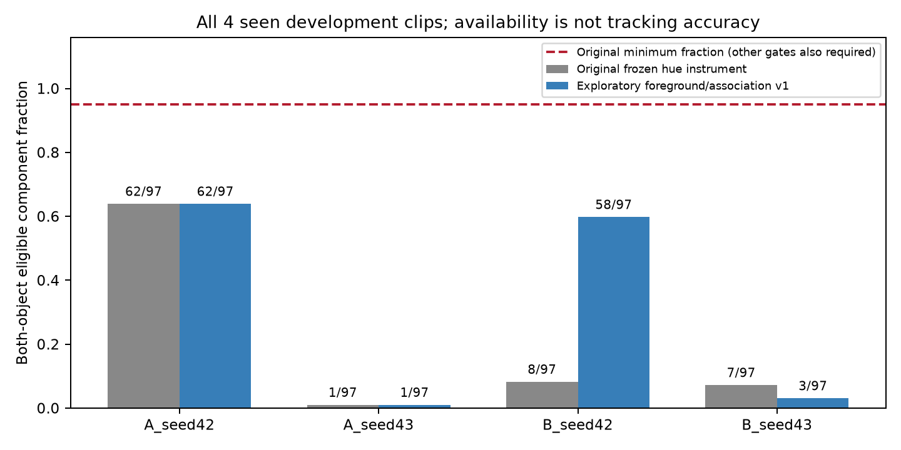
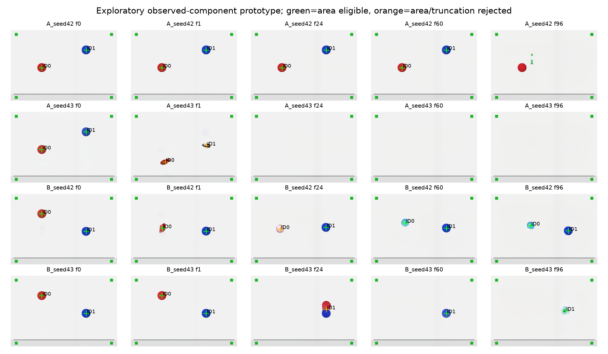

# 跟踪覆盖率失败：根因检查、修正试验与三维方法阅读

2026-11-15。**覆盖失败同时来自测量器限制和生成图像异常，不能全部归为模型物理失败。** 本轮逐帧复现了旧检测器的全部 388 个双对象可用性决定，确认了角标数量误判与颜色身份绑定两类问题，并做了独立控制后的最小修正试验。空间角标匹配有效；颜色无关前景原型能恢复部分观测，但没有通过持续身份挑战，因此不升级为生产物理测量器，也不扩样。

论文方法精读见 [READING_2D_TO_3D.zh.md](READING_2D_TO_3D.zh.md)，覆盖 CoTracker3、SpatialTracker、MegaSaM、TAPIP3D 的方法、实验边界、相关附录及几何小例子。当前更合适的顺序是先验证二维持续身份/可见性，再判断三维深度是否提供可靠增量；不能用三维先验补出的轨迹替代原图观测。

## 研究问题、样本和只读边界

数据来源为上一轮 `../principia_i2v_20261115/` 的四次原生 LTX-Video 0.9.5 生成：A/B 两个人工初态各 seed42/43，每段97帧、24FPS、768×512。原始量化数组是主要输入；不重新解码有损 MP4 来测量，也没有重生成视频。

四个生成样本是已看过的开发材料；新修正后在这四段上的结果属于探索性重分析，不能称为未见验证。帧是重复观测，不是独立实验。新增64个程序化控制是8种条件×8个种子，每序列17帧；此外增加1个6帧的身份替换挑战。所有位置真值来自明确的控制渲染器，没有伪造人工标签。

运行前保存 `original_before.sha256.json`，本轮结束再次核验旧目录125个文件全部不变；旧 `pilot_gate.json`、生产源码、输入与四段结果没有改写。新假设与固定参数在 [CORRECTION_PROTOCOL.md](CORRECTION_PROTOCOL.md)。新原型和旧检测器的精确代码差异在 `reanalysis_v1/correction.patch`，旧适配器保存在 `candidate_before.py`。

不使用显著性检验或总体正确率推断。以下比率只描述相应数据集与规则下的仪器可用性；没有真实生成视频的定位/身份人工真值，不能把覆盖率改进叫作准确率改进。

## 一、旧门具体在哪里拒绝

[diagnosis/summary.json](diagnosis/summary.json) 与 `diagnosis/frame_audit.csv` 将 `missing_or_ambiguous` 拆成零候选、多候选、面积不符和截断。独立重算的逐帧双对象判断与旧结果完全相同，故这不是帧数、顺序、视频编码或 FPS 差异导致的覆盖变化。

| 片段 | 首次双对象不可用帧 | 旧双对象可用帧 | 左对象的拒绝 | 右对象的拒绝 |
|---|---:|---:|---|---|
| A/42 | 62（2.583s） | 62/97 | 无，97帧通过 | 35帧零颜色候选 |
| A/43 | 1（0.042s） | 1/97 | 87帧零候选、1帧多候选、2帧面积、5帧截断 | 92帧零候选、1帧多候选、3帧面积 |
| B/42 | 1（0.042s） | 8/97 | 79帧零候选、2帧多候选、8帧面积 | 28帧多颜色候选 |
| B/43 | 3（0.125s） | 7/97 | 86帧零候选 | 10帧零候选、1帧多候选、3帧面积 |

颜色候选来自固定 HSV 阈值（色相距离≤12，饱和度≥110，亮度≥90，连通域面积≥40）。这实际上是每帧按颜色分割，不是维持材料身份的时序跟踪。淡出、变灰、变蓝会触发零候选或多候选；零颜色候选并不等于图像里没有任何可见轮廓。

### 角标错误：新增绿色区域被当成角标缺失

A/42的17帧和B/43的7帧，旧函数因全图绿色连通域数量不等于4而拒绝：A/42分别有1帧5个、16帧6个；B/43有7帧5个。重新将所有绿色候选与四个已知角标位置匹配后，四段的四个原角标均在全部97帧可找到，均在1.5px范围内。**这24帧是额外绿色伪影，不是原角标真的缺失。**

这会影响相机/装置和旧物理测量器的拒绝原因，却不会单独修好双对象覆盖率：原覆盖公式本身只计对象条件，不含角标条件。必须分别修正、分别报告。

### 对象错误：颜色与身份绑定，且唯一性按全图判断

B/42 的左侧前景逐渐变浅并变为青蓝色；右球所在区域仍可见时，全图蓝色候选可变成两个，旧右球检测于是拒绝28帧。对象身份不应因另一个地方出现同色物体就自动消失。另一方面，A/43 的变形、截断及消失并非只换一个色相阈值就能解决。

面积门也与“是否检测到前景”混在一起：对象仍可能有可关联轮廓，但面积已不适合原先的等尺寸落体测量。不能为了提高覆盖而直接放宽原面积门；应保留“观测到候选”和“满足物理测量几何条件”两列。

## 二、先控制验证，再尝试修正

修正1保留绿色阈值及最小面积，按已知角标位置做唯一、一对一空间关联（12px搜索范围）；最终仍要求所有97帧单个标记漂移≤1.5px，缺失和局部歧义照样拒绝。四段新相机门均通过，最大单标记漂移为0.0644px；原24帧误判消除。

修正2是限定在静态、近乎均匀背景上的观测原型：用输入图像逐行 RGB 中位数建立背景；像素最大通道差>20视作前景；仅遮掉已知角标范围。组件不依赖色相，以前一观测中心周围4个输入半径范围做相互唯一的空间关联。缺失帧不补位置；最多保留2帧关联记忆，超过则终止身份，候选竞争也保守终止。面积和截断继续用原阈值评估，但不与当前是否观测到候选混为一列。

该方法没有学习特征、深度网络或重力先验，不能称为 CoTracker3 或任何三维论文的实现。它仅用来检验“旧颜色规则是不是过早丢掉可见证据”这一假设。

先在旧适配器上运行9项回归：3项失败、6项通过，具体复现额外绿色误判、同色/灰色失踪、长缺失后重新贴身份的问题；新原型9项通过，日志为 `regression_before.log` / `regression_after.log`。随后固定源码与协议哈希，在新种子710–717的64个控制（1088帧）上验证后，才运行四段重分析。

| 程序化条件（每行8序列×17帧） | 原颜色法双对象可用帧 | 新原型双对象可用帧 | 解释 |
|---|---:|---:|---|
| 外观不变 | 136/136 | 136/136 | 简单正例 |
| 换色 | 32/136 | 136/136 | 固定色相限制可修正 |
| 灰度 | 32/136 | 136/136 | 固定饱和度限制可修正 |
| 两球同色 | 32/136 | 136/136 | 全图唯一性限制可修正 |
| 额外绿色 | 136/136 | 136/136 | 对象门原本不受角标数影响 |
| 消失后重现 | 104/136 | 48/136 | 新规则不在长缺失后自动宣称原身份 |
| 邻近干扰 | 136/136 | 40/136 | 新规则主动拒绝身份歧义，覆盖更低 |
| 交叠 | 56/136 | 48/136 | 保守拒绝多对象竞争 |

这些64个控制均满足其预设验收：简单外观条件全程可用；已返回且真值可评分的位置最大误差0px；已知缺失和规定的歧义段没有错误观测。后3行的“通过”包含正确弃权，不能解读成全程跟踪成功。几何是理想实心圆，位置0px不代表生成视频达到亚像素精度，也不足以证明一般误报率。

## 三、四段修正结果：局部改善，没有解锁扩样

指标仍使用每段97帧固定分母、面积比例0.75–1.25、完整组件、至少95%且最长不可用段≤2。两种仪器的身份规则不同，必须展示全部四段而不能逐片择优拼接。

| 片段 | 原覆盖率 | 新原型覆盖率 | 新最长不可用段 | 结论 |
|---|---:|---:|---:|---|
| A/42 | 62/97，63.9% | 62/97，63.9% | 35帧 | 淡出后无可持续双对象观测 |
| A/43 | 1/97，1.0% | 1/97，1.0% | 96帧 | 变形/歧义仍严重 |
| B/42 | 8/97，8.2% | 58/97，59.8% | 31帧 | 部分颜色导致的拒绝可恢复，仍有39帧左前景面积不符 |
| B/43 | 7/97，7.2% | 3/97，3.1% | 94帧 | 保守身份终止不把重现自动接回原对象 |

B/42 在新原型下两侧各97帧都有可关联前景组件，左侧58帧、右侧97帧满足面积/完整性；这证明原规则确有观测损失，但并未证明97帧材料身份都正确。A/42 后期新增伪影还会令新原型的红球关联弃权，即使旧颜色组件仍存在；新方法并非处处更优。





叠图仅表示算法返回的前景中心，绿色为符合面积门、橙色为面积/截断拒绝；“ID0/1”是原型所声称的关联，**不是已核实的真实身份标签**。B/43 的局部合并及再现恰好暴露这一局限。

## 四、主动找反例：身份替换挑战失败，阻止原型升级

64个简单控制并没有覆盖“一个对象丢失后，另一个位置的对象被替换”这一风险。因此在不修改候选代码的前提下，新增6帧、有渲染器身份真值的挑战：帧0含A/B；帧1只有B；帧2–5移走B，把A画在B此前的位置。新原型在B实际缺失的4帧里，**4帧都错误声称仍观测到B**。结果与原始帧保存在 `identity_challenge_v1/`。

这不是把“返回一个点”当作测量成功：挑战明确判 `passed_identity_safety=false`，新原型不用于物理评分。图像证据可以支持“这里有前景”，但简单空间连续性不能独自证实材料身份。三维深度先验也不能凭空给消失/替换提供身份真值。若两个不同历史生成完全相同图像，正确做法是保留歧义，而不是宣称所有历史都可辨识。

因此，本轮可采用的具体修正是按空间匹配已知角标；对象部分只得到一个诊断原型及其反例，没有彻底解决持续身份。原四段覆盖门仍0/4通过，原 `expand_generation=false` 保持；没有新的有效物理分数或 leaderboard。

## 五、论文阅读改变了什么判断

完整公式与例子见 [精读笔记](READING_2D_TO_3D.zh.md)。主要结论来自以下原始论文，并结合当前数据作出推断：

- [CoTracker3](https://arxiv.org/html/2410.11831v1)：持续查询、可见性和定位置信度应分开。对我们而言，应验证身份交换与不可见点误计，不只是输出轨迹长度。
- [SpatialTracker](https://arxiv.org/html/2404.04319v1)：深度和刚性先验可以帮助跟踪，但若评价视频是否变形，不能用 ARAP 正则化后的刚性结果当作独立证据。
- [MegaSaM](https://arxiv.org/html/2412.04463v2)：固定相机下某些深度量缺少多视角约束。本轮的平背景/固定相机输入尤其需要报告先验依赖。
- [TAPIP3D](https://arxiv.org/html/2504.14717v3)：世界坐标与三维邻域的收益依赖几何质量，不能预设三维一定改善二维定位。

本轮只阅读与理解，没有安装或运行这四个作者模型，也未声称完成米制三维重建。下一阶段优先在已知轨迹、外观变化和身份交换控制上验证持续二维点/实例跟踪；取得定位/可见性/身份真值后，再比较已知深度、传感器/双目深度、单目估计深度带来的增量。固定相机、同平面关系若已能可靠用二维测量，应先保留其明确假设。

## 验证、软件与可复现入口

使用 `/home/room115/pytorch_env/bin/python`，Python3.12.3；numpy2.5.3、scipy1.18.1、opencv-python4.13.0.92、matplotlib3.11.2、Pillow12.3.0、requests2.33.1、beautifulsoup4=4.14.3、pytest9.0.3。本轮没有安装依赖、下载模型权重或调用付费推理；软件记录在 `artifacts/verification.json`。

实际执行命令，项目根目录下：

```bash
/home/room115/pytorch_env/bin/python research/tracking_audit_20261115/diagnose.py
/home/room115/pytorch_env/bin/python -m pytest -q -p no:cacheprovider research/tracking_audit_20261115/test_correction.py
/home/room115/pytorch_env/bin/python research/tracking_audit_20261115/run_correction.py --phase controls
/home/room115/pytorch_env/bin/python research/tracking_audit_20261115/run_correction.py --phase reanalysis
/home/room115/pytorch_env/bin/python research/tracking_audit_20261115/identity_challenge.py
/home/room115/pytorch_env/bin/python research/tracking_audit_20261115/finish_artifacts.py
/home/room115/pytorch_env/bin/python -m pytest -q -p no:cacheprovider
```

针对性回归9项通过；仓库默认测试83项通过（8.51s，`project_tests.log`）。默认 pytest.ini 的 testpaths=tests，不包含新研究目录，所以两次测试结果分开记录，不把83项说成包含新9项。预设身份挑战失败单独保留，测试绿灯并不覆盖该科学失败。复跑会拒绝覆盖原输出，应在新副本中进行；原始输入和全部控制/派生结果保留。

论文归档含4篇文章的6个版本，原始网页与文本哈希已核验。图片抓取初次进程退出143（没有据此猜测具体网络原因），4张方法图片已保留；缺失的 SpatialTracker 图2重试在显式25s时限退出124。本地未取得该图片，只读了方法和图注。期刊页面曾返回403，改用作者 arXiv 全文。以上获取限制不影响本轮对已取得正文的阅读，但不冒充完整补充视频审查。LSP basedpyright 未安装，遵照此前偏好未安装，采用实际执行验证。

报告使用了科学批判性检查流程；程序性软件来源另记 [Kassis, T., Agarwal, V., He, Y., Patel, D., & Brueckner, A. M. (2026). Scientific Agent Skills: A Library of Procedural Knowledge for Research Agents](https://doi.org/10.48550/arXiv.2609.00065)（已核实当前 arXiv 记录，非本轮物理/跟踪算法来源）。

全部新产物及旧输入的只读副本将保存至版本化 `shared/handoff`，位置和校验见 `handoff_receipt.json`。本轮没有公开上传，没有新增人类标注，没有放宽旧实验阈值，也没有把未解决的身份问题写成完成。
