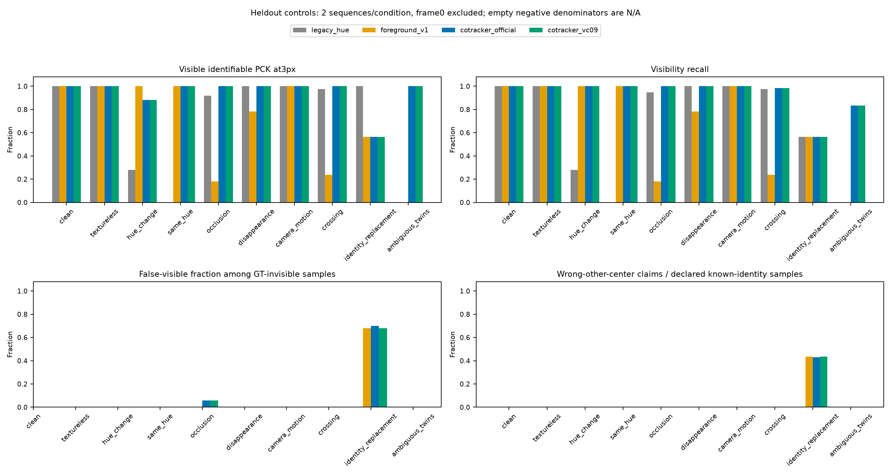
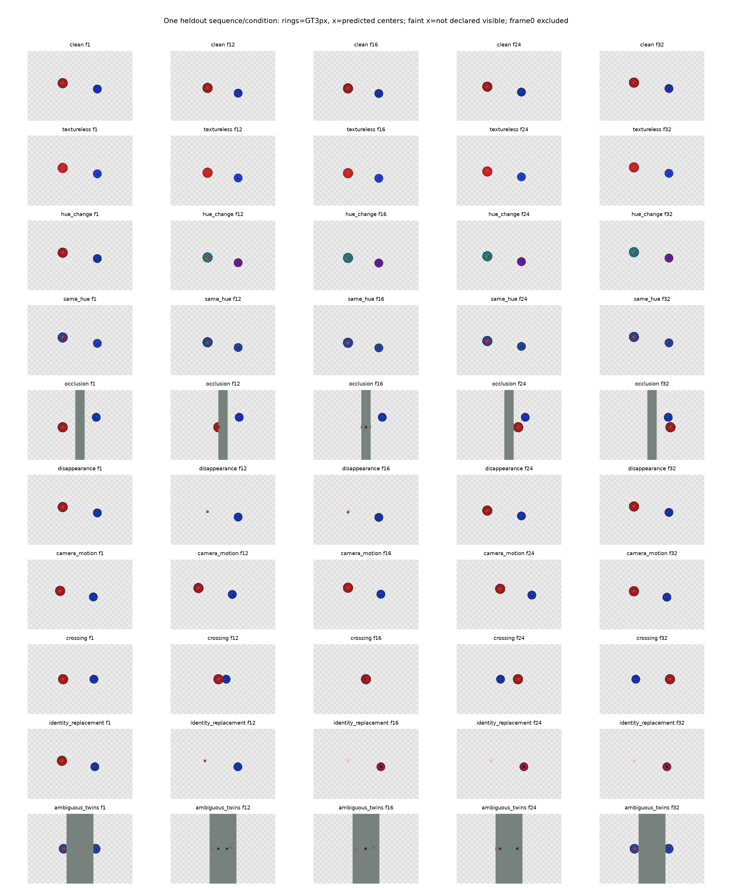
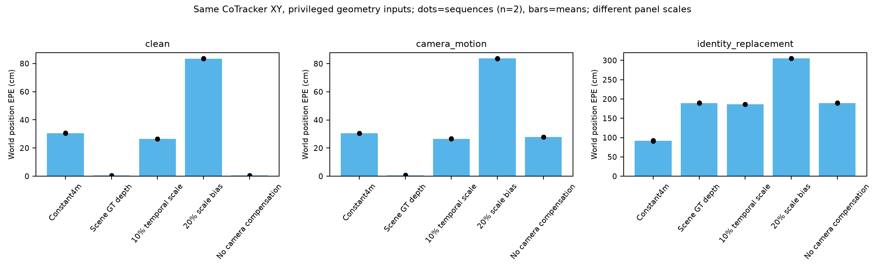

# 持续二维身份、可见性与定位验证，以及三维几何信息对照

日期：2026-11-15。**已完成30段有精确真值的控制视频、官方 CoTracker3 推理、两种旧仪器对照，以及保持二维预测不变的深度/相机信息比较。二维身份与可见性生产门没有通过，因此不扩样，也不将跟踪结果接入物理评分。** 完整学习式三维跟踪模型比较尚未进行；本轮三维结果是几何信息增益与误差传播对照。

关键结果：CoTracker3 在同色、消失重现和交叉运动上补上了旧仪器的部分短板，但换色后的定位、遮挡边界和身份替换仍会失败。身份替换条件中，官方可见性规则将35/50个不可见样本错误声明为可见；乘上定位置信度后仍有34/50。单纯收紧这个分数不足以提供持续材料身份的证据。

## 1. 问题、实验单位与数据

承接 [上一轮诊断](../tracking_audit_20261115/REPORT.zh.md)。本轮把“输出坐标”“当前可见”“仍为同一对象”“定位准确”分开验证，再检查深度和相机信息能为相同二维坐标提供多少三维信息。

最终有效数据是 `data_v2/` 与 `data_manifest_v2.json`：10种条件×3个种子，共30段、990帧；每段33帧、384×256、24FPS。开发种子910有10段，留出种子1910/2910各10段。30个原始视频像素哈希均不同，开发/留出之间没有像素重复。正式推理前源码快照 `source_snapshots/dataset_v2/` 时间为2026-11-15T05:33:51.862710+00:00。

条件为 clean、textureless、hue_change、same_hue、occlusion、disappearance、camera_motion、crossing、identity_replacement、ambiguous_twins。数据是具有纹理的圆形平面物体，渲染器精确给出材料点世界坐标、投影、相机、深度和z-buffer可见性。没有人类标注，不冒充真实拍摄视频或三维球体重建。身份替换条件假设物体纹理持续对应；不可辨识的同形同纹理历史则单独标注。

每对象5个材料查询点：中心及四个0.4半径偏移点，共10点。主方法间比较只用两个中心查询，辅助10点指标另外保存。这里的中心是非旋转平面控制物体上定义的材料点，不应推广为任意旋转/变形三维物体的质心。

**序列是实验单位**：留出每条件仅2个种子重复。帧、点是重复测量；不据它们构造独立样本量、总体误报率置信区间、P值或显著性结论。所有数字只描述这个小型控制集。旧四段I2V没有人工身份真值，本轮不把它们当准确率测试集，也没有重新生成或修改它们。

## 2. 固定模型、方法和指标

使用原作者 [CoTracker3代码](https://github.com/facebookresearch/co-tracker/blob/82e02e8029753ad4ef13cf06be7f4fc5facdda4d/cotracker/predictor.py)，固定源码提交 `82e02e8029753ad4ef13cf06be7f4fc5facdda4d`；模型为 [facebook/cotracker3](https://huggingface.co/facebook/cotracker3/tree/bf55ea50d4390e1820a267f131cd6587240fb2c5) 的 `scaled_offline.pth`，SHA256 `2670d4562ed69326dda775a26e54883925cd11b6fc9b24cb7aa9f8078bce7834`。34个源码文件的Git blob/内容哈希和检查点均已核验。没有修改作者模型源码，没有安装新依赖。

固定 offline、window_len60、6次更新、6×6支持点、FP32，采用原生384×512内部重采样。一次联合追踪10个已知初态查询，不能称为严格复现论文的单查询 benchmark。模型只读取 RGB 与初始查询，不读取未来位置、可见性、深度或实例图；原始visibility/confidence由只读返回值观察器保留。

四种比较方法：

| 方法 | 坐标与可见性来源 |
|---|---|
| legacy_hue | 原冻结颜色连通域；完整性/面积门决定当前观测可用性 |
| foreground_v1 | 上一轮未升级的静态背景与空间关联原型；保留其缺失后终止身份规则 |
| cotracker_official | 原生坐标与作者封装的 visibility>0.9 |
| cotracker_vc09 | 同一坐标，事前固定 visibility×confidence>0.9 |

后者是固定的应用层对照，**不是已校准概率**。旧前景原型额外得到初始半径、面积等几何信息，是对它有利的输入条件；颜色基线同样得到初始颜色。两个旧方法都保持源码和阈值不变。

作者封装会将查询帧位置和可见性强制设回输入，因此主指标排除帧0，每段仅计其余32帧。每条件留出样本的两个中心最多贡献128个重复测量点时刻。指标分开计算：可见且身份可辨识样本的PCK≤3px；可见性精度/召回；真实不可见时的错误可见比例；距离其他真实可见对象中心≤5px的错误关联声明及关联身份转换；不可辨识历史中的无证据身份声明。

主门在 [PROTOCOL.md](PROTOCOL.md) 中事先固定：每个留出条件PCK≥90%、可见精度≥99%、召回≥90%；有不可见负例时错误可见≤1%，他物关联声明≤1%。对称不可辨识历史另要求测量系统不要无证据确定身份。负例分母为零时为N/A，不写成已证明零误报。不能把该应用门的失败等同于通用跟踪论文 benchmark 失败。

## 3. 二维结果：出现新能力，但生产门仍失败

最终结果来源 [results_v2/two_d.json](results_v2/two_d.json) 与 [逐序列CSV](results_v2/two_d_cases.csv)。官方 CoTracker3 在6/10种留出条件通过本协议全部门：clean、textureless、same_hue、disappearance、camera_motion、crossing。乘置信度后的规则也为6/10。旧颜色法6/10，前景原型5/10，但通过的条件不同；不能用这个计数宣布一种方法整体优于另一种。

| 留出条件 | 官方CoTracker3 PCK≤3px | 可见性召回 | 不可见时错称可见 | 关键判断 |
|---|---:|---:|---:|---|
| clean | 128/128，100% | 100% | N/A | 本控制通过 |
| textureless | 128/128，100% | 100% | N/A | 本控制通过 |
| same_hue | 128/128，100% | 100% | N/A | 颜色全图唯一性限制被绕过 |
| disappearance | 110/110，100% | 100% | 0/18 | 可在本控制重现后恢复 |
| camera_motion | 128/128，100% | 100% | N/A | 本控制通过 |
| crossing | 118/118，100% | 116/118，98.3% | 0/10 | 与旧前景原型23.7%召回相比明显不同 |
| hue_change | 113/128，88.3% | 100% | N/A | 有输出/有信心仍可能定位偏移 |
| occlusion | 111/111，100% | 100% | 1/17，5.9% | 遮挡边界误称可见，未过负例门 |
| identity_replacement | 44/78，56.4% | 44/78，56.4% | 35/50，70.0% | 严重身份/可见性失败 |
| ambiguous_twins | 12/12，100% | 10/12，83.3% | 可辨识段0/32 | 另有8/84个歧义时刻声称确定身份 |

同色条件下颜色基线无法给出有效两个中心；前景原型和CoTracker3均可处理。换色条件下前景原型反而取得100% PCK，而CoTracker3为88.3%。这些控制表明不同仪器在不同假设下失效，不能只选择新方法更好的条件报告。

身份替换时，官方规则的可见精度为44/79=55.7%；有34/79=43.0%的声明坐标落在另一个对象中心附近，按本协议有2次关联身份转换。可见性×置信度规则只把错误可见从35/50降至34/50=68.0%，可见精度44/78=56.4%，仍有34次他物关联声明。这些是本协议的中心匹配诊断，不是未经定义的标准MOT IDSW指标。

ambiguous_twins 中，两物体同形、同深度、同纹理，遮挡后的不同身份历史可以产生相同观测。从帧12开始不把某个渲染历史冒充唯一可辨识答案；8/84=9.5%表示系统仍返回了没有独立身份支持的可见点声明，并非证明这8次都与潜在材料真值相反。这里需要应用层表达不确定性；通用点跟踪器的可见性并不保证材料身份已被证实。





叠图中圆环是渲染器投影的3px范围；叉号是跟踪器估计，淡叉表示未声明可见。绿色/黑色圆环分别表示GT可见/不可见，黑环出现在遮挡物上只是显示已知模拟投影，不代表图像中真的看到了被遮挡点。所有30段的坐标和置信度均保存，而图只选固定种子和相同帧位置示意。

## 4. 三维信息对照：正确几何有用，错误身份不会自动消失

二维验证完成后，在**相同官方CoTracker3二维预测**上比较五种输入：固定4m深度；预测像素处采样的场景GT深度；GT深度加10%正弦时间尺度扰动；GT深度加20%尺度偏差；GT深度但不补偿相机平移。已知相机、深度属于明确标注的特权信息，不是旧生成视频可直接获得的真值。

使用固定内参反投影和已知相机中心恢复世界坐标，没有使用GT作尺度拟合、没有动力学/刚性平滑，也没有调用学习式三维跟踪器。主对照在所有GT可见、身份可辨识的中心查询上计算，**不因某深度变体表现不好而换样本**；另外保存了仅声明可见子集。反投影失败单独计数，完整字段在 [geometry.json](results_v2/geometry.json)。

下表是两段留出序列的逐序列平均误差再取均值，单位cm：

| 相同二维预测上的几何条件 | clean | camera_motion | identity_replacement |
|---|---:|---:|---:|
| 固定4m深度，已知相机 | 30.56 | 30.56 | 91.90 |
| 场景GT深度，已知相机 | 0.55 | 0.60 | 189.69 |
| GT深度×10%时序尺度扰动 | 26.55 | 26.64 | 186.31 |
| GT深度×1.2 | 83.51 | 83.66 | 305.02 |
| 场景GT深度，不补偿相机 | 0.55 | 27.78 | 189.69 |

在正确对应的相机运动控制里，补偿已知相机运动将误差从27.78cm降至0.60cm；但10%时序深度尺度扰动使误差达到26.64cm。这量化了几何信息与深度误差的影响，**不是单目深度模型实际能达到0.60cm的证据**。

身份替换条件中，“GT场景深度”反而比固定4m先验误差大，因为错误二维对应可能采到背景或另一对象的深度。场景深度真实，不意味着预测点属于真实目标。这个反例阻止我们把“使用深度/输出三维坐标”当作身份可靠性的替代证明。

几何实现检查：使用准确GT像素和深度反投影时，最大世界误差为3.21×10⁻⁷m；各深度提升回投影与原二维预测的最大差仅3.05×10⁻⁵px。后者是保持XY不变的代数结果，因此**本对照没有验证完整三维跟踪模型能否改善二维跟踪**，也不排除它们在可靠深度下改善对应。它只是为下一阶段识别何种几何信息值得引入。



黑点为两段留出序列，柱为均值，无误差线；不同面板量程明确不同。完整逐序列数据在 [geometry_cases.csv](results_v2/geometry_cases.csv)。

## 5. 失败、修订与复现证据

首次开发推理发生记录接口失败：作者封装直接调用子模型 `.forward()`，绕过PyTorch模块hook，导致没有捕获原始分数。修订为只读的返回值观察器后，返回原始张量元组不作更改。初次失败收据在 `predictions/primary/development/clean_910.json`，错误日志保留；这不是看结果后重选模型。

初版输入哈希审计发现 occlusion、crossing、ambiguous_twins 覆盖了随机扰动，导致跨集合重复。初版 `data/`、`data_manifest.json`、`predictions/observer_v2/` 和 `results/` 保留，**不作为最终留出验证**。根据输入重复修正生成器，保留已采样几何扰动（同形物体使用公共平移以保持对称性），重新生成 `data_v2/`，先确认30个视频像素哈希不同，再冻结源码并重跑全部30段；没有依据得分修改阈值。21个输入完全不变的重复运行，其坐标最大差为0px。详细修订在 [ENGINEERING_CORRECTIONS.md](ENGINEERING_CORRECTIONS.md)。

验证结果：8项指标/几何合同测试从未实现的预期失败变为通过，之后加上3项数据完整性测试，最终11项通过；仓库默认测试83项通过（8.28s）。默认测试目录不含新研究目录，因此两组测试分开记录。科学上的身份门失败不会被测试通过掩盖。

`verification_figures_v2.json` 确认：最终30次推理均成功、990帧；检查点和34个作者源码文件哈希匹配；生产快照8个源码文件不变；旧基线源码/旧结果哈希不变；无跨集合像素重复。当前LSP basedpyright未安装，按照此前偏好未安装，通过实际Python运行验证。本轮没有新增模型运行warnings；最初hook失败和数据拆分缺陷均有保留记录。

软件：`/home/room115/pytorch_env/bin/python`，Python3.12.3，Torch2.9.0+cu128、numpy2.5.3、scipy1.18.1、opencv-python4.13.0.92、matplotlib3.11.2、Pillow12.3.0、einops0.8.2、pytest9.0.3。GPU为两张RTX5090。依赖与资产记录分别在 `verification_figures_v2.json` 和 `assets.json`。

实际核心执行入口（项目根目录；已存在的输出不可覆盖，复跑须用新副本/新运行名）：

```bash
/home/room115/pytorch_env/bin/python research/tracking_validation_20261115/render_controls.py --version v2
/home/room115/pytorch_env/bin/python research/tracking_validation_20261115/run_cotracker.py --split development --gpu 0 --run-name dataset_v2 --data-manifest data_manifest_v2.json
/home/room115/pytorch_env/bin/python research/tracking_validation_20261115/run_cotracker.py --split heldout --gpu 1 --run-name dataset_v2 --data-manifest data_manifest_v2.json
/home/room115/pytorch_env/bin/python research/tracking_validation_20261115/assess.py --run-name dataset_v2 --data-manifest data_manifest_v2.json --snapshot dataset_v2 --output results_v2
/home/room115/pytorch_env/bin/python research/tracking_validation_20261115/summarize.py --output figures_v2
/home/room115/pytorch_env/bin/python -m pytest -q -p no:cacheprovider research/tracking_validation_20261115/test_metrics.py research/tracking_validation_20261115/test_data_integrity.py
```

## 6. 决策与下一项可验证工作

这轮完成的是官方二维点跟踪的受控验证与几何信息消融。**二维生产门仍未通过，完整TAPIP3D/MegaSaM等学习式三维模型的配对比较尚未启动。** 原论文阅读和方法边界见 [上一轮精读笔记](../tracking_audit_20261115/READING_2D_TO_3D.zh.md)；它们支持三维表示可能有帮助，但当前实验不能给这些模型排名。

下一项优先工作是独立的身份/遮挡观测门：以持续纹理或实例证据判断目标是否仍为原对象，在身份突变、候选竞争、遮挡边界时能明确弃权；不把CoTracker3可见性或较高confidence直接当材料身份概率。新的方案可以用本轮失败样本开发，但必须另留新控制与新初态验证，当前留出集不能继续充当调参后的未见集。

只有该门与定位要求通过，才在相同查询、相同可见性定义下引入估计深度/相机，并与本轮明确的GT几何上界比较，再运行完整三维跟踪模型。后续自然图像/原生I2V仍需要独立的定位、身份和可见性标注；程序化控制不会替代它们。旧 Part B 校准、物理排名、人类标签等均未被本轮结果自动完成。

原始控制、所有尝试与失败、作者资产、冻结源码、逐序列指标和图表保存在本目录；版本化本地共享交付位置与哈希见 `handoff_receipt.json`。未公开上传，未调用付费推理，未扩大视频生成。
